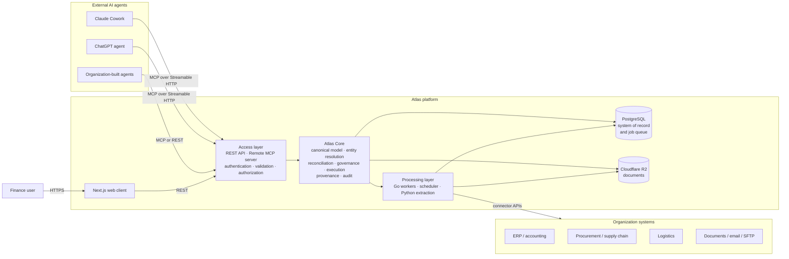
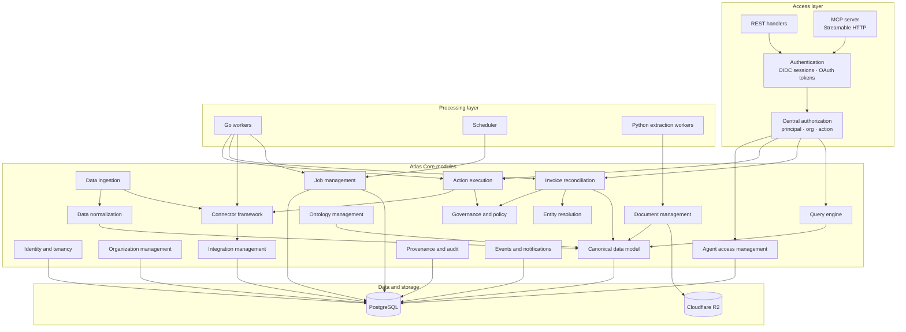
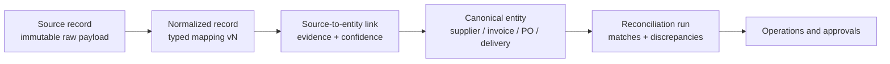
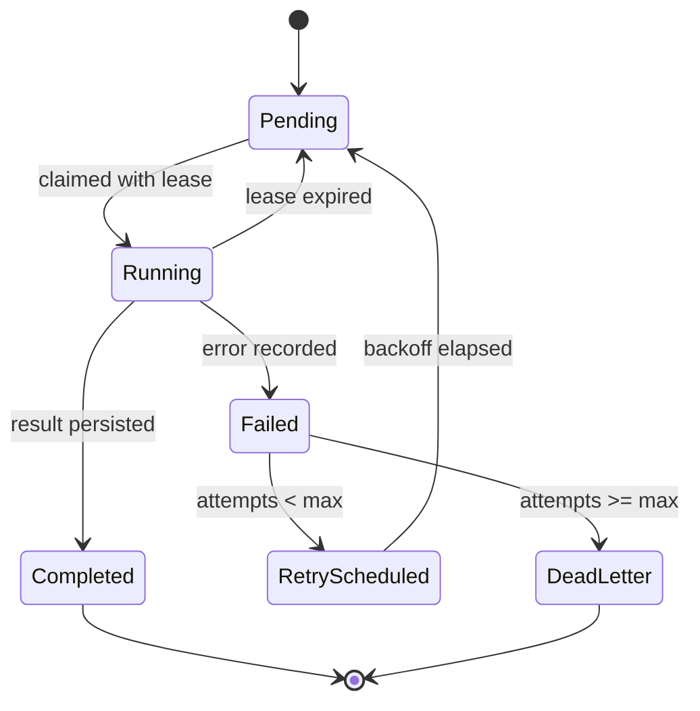
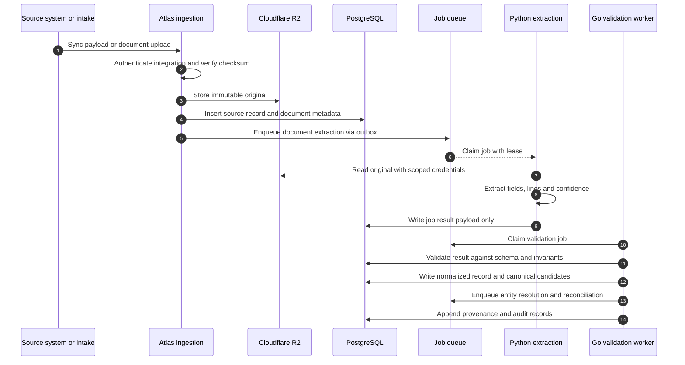
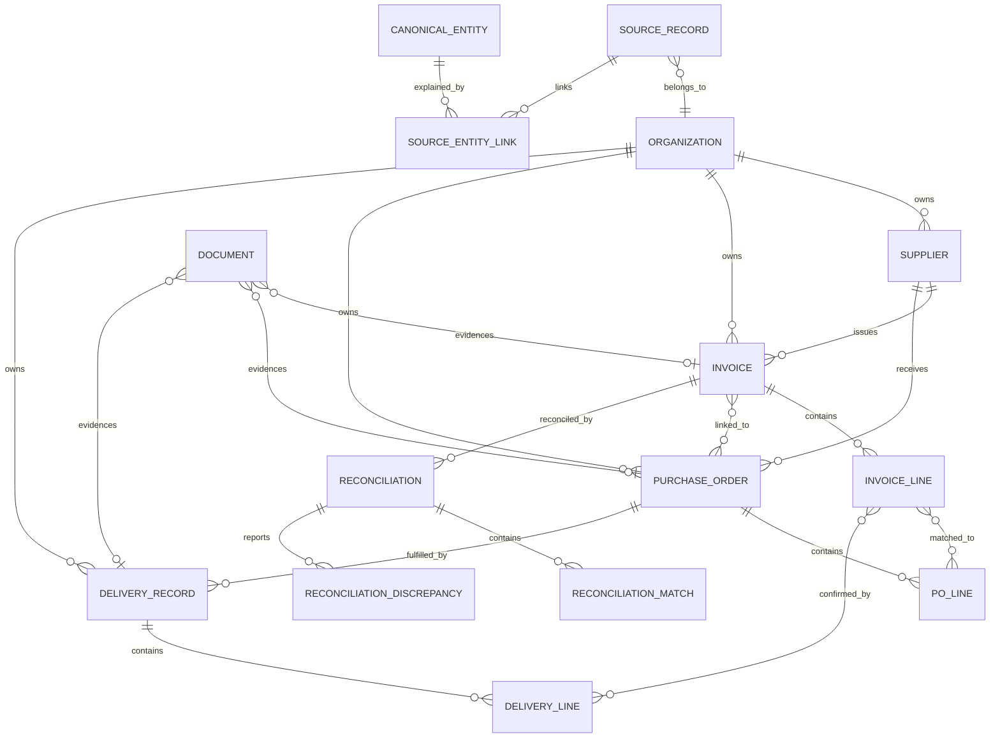
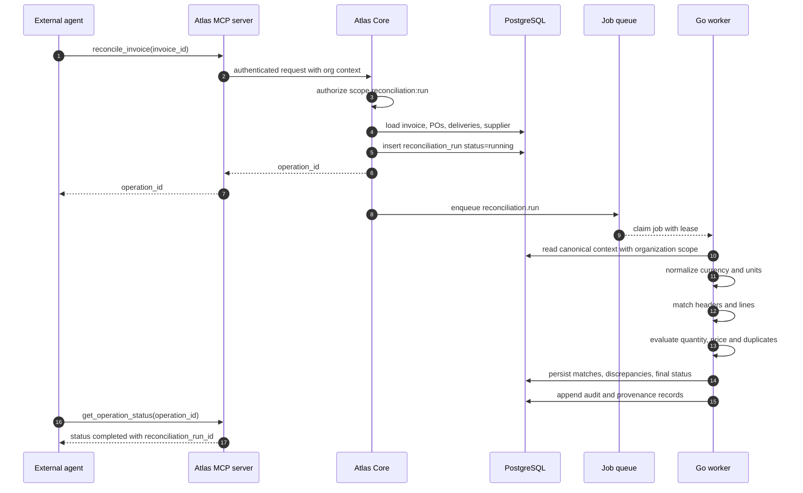
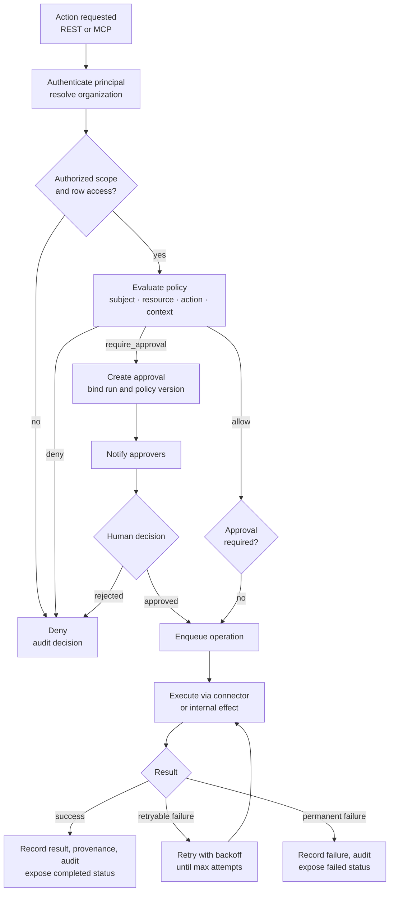
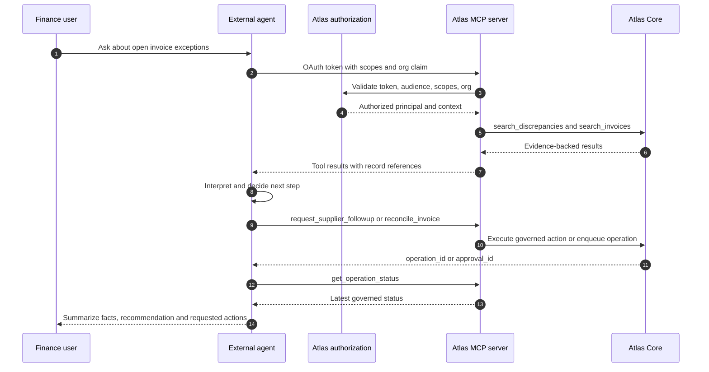
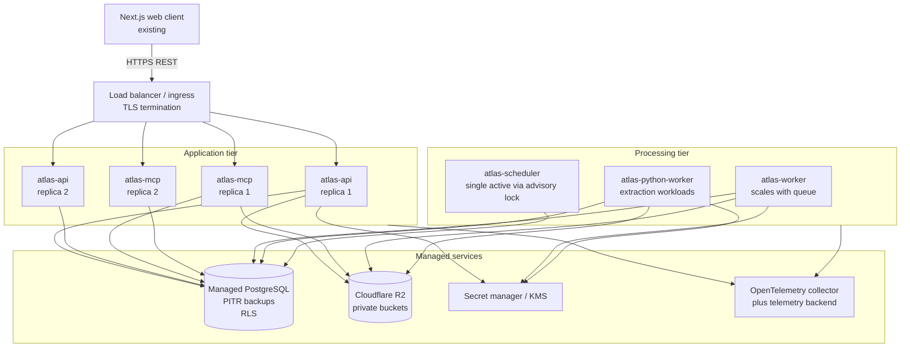

# Atlas — Technical Architecture Specification

**Status:** Draft v1 · target architecture for Atlas v0
**Scope:** Backend, data, security, interfaces, deployment and architectural decisions
**Audience:** Engineers joining Atlas, reviewers of the v0 design, and implementers of the Go backend
**Companion document:** [`roadmap.md`](./roadmap.md) — phased implementation plan, execution protocol and
implementation status tracking. The roadmap contains no architecture of its own; where the two disagree,
this document prevails.

> **Important:** This repository currently contains the Atlas **frontend reference implementation** — a
> Next.js application with an in-browser workflow prototype backed by SQLite, deterministic demo logic and
> simulated integrations. The target architecture described in this document is **not yet implemented**.
> Section 2.2 records what exists, and Section 2.3 states how the existing work is reconciled with the
> target. No claim in this document should be read as describing already-delivered backend functionality.

---

## 1. Purpose

This document is the technical source of truth for how Atlas is built. It explains the components of the
system, where responsibilities live, how data moves from external systems into Atlas's canonical model and
out to connected AI agents, how authorization and governance are enforced, and in what order the system
should be implemented.

It deliberately separates three things that are easy to conflate:

1. **The product** — governance of AI-agent access to an organization's operational reality, starting with
   invoice reconciliation.
2. **The current repository** — a polished frontend prototype used to validate the product workflow and UX.
3. **The target v0 architecture** — a Go-based, multi-tenant backend with a remote MCP server, deterministic
   reconciliation, PostgreSQL, object storage and asynchronous processing.

Where the prototype and the target differ, the difference is stated explicitly rather than silently resolved.

---

## 2. Architecture overview

Atlas is an **open control plane** that lets organizations give their AI agents governed access to their
enterprise reality. It sits between an organization's existing systems and the AI agents the organization
chooses to use. **Atlas does not build, host or provide agents**: customer organizations connect their own
agents to Atlas's governed interfaces (MCP and REST). External agents reason, plan and decide. Atlas
understands company data, establishes relationships, produces factual reconciliation results, enforces policy,
and executes only permitted operations.

The v0 system is a **modular monolith** written primarily in Go, with a small Python processing runtime for
document extraction. It exposes two interfaces over the same application services:

- a **remote MCP server** (Streamable HTTP transport) as the primary agent connection method, and
- a **REST API** used by the Atlas web client, administrative tooling and programmatic integrations.

PostgreSQL is the system of record and the initial job queue. Cloudflare R2 stores original documents.
Background workers run connector synchronization, document extraction, entity resolution, reconciliation and
action execution. A single Next.js frontend, already present in this repository, remains the human-facing
product UI.

### 2.1 Target system at a glance

| Concern | v0 direction |
|---|---|
| Backend language | Go (Atlas Core), Python (specialized processing workers) |
| Backend shape | Modular monolith, multiple runnable processes from one codebase |
| System of record | PostgreSQL |
| Database access | `pgx` + `sqlc` with explicit SQL |
| Documents | Cloudflare R2 via S3-compatible API |
| Asynchronous work | PostgreSQL-backed job queue with leases and retries |
| Agent connectivity | Remote MCP server, Streamable HTTP, MCP-compatible OAuth |
| Programmatic interface | REST |
| Human interface | Existing Next.js web client |
| Tenancy | Organization-scoped records + PostgreSQL RLS + application authorization |
| Observability | OpenTelemetry across Go and Python |
| Deployment | Containers on managed infrastructure (no Kubernetes, no microservices) |

### 2.2 What exists in this repository today

An honest inventory of the current implementation:

| Area | Current state |
|---|---|
| Web client | Next.js 16 (App Router), React 19, TypeScript, Tailwind v4, shadcn/ui. Six sections: Work, Invoices, Suppliers, Approvals, Activity, Settings. Master–detail Work queue with right-side drawer, document preview modals, filters, sortable invoice table, activity timeline with event inspector. |
| Persistence | SQLite (`atlas.db`) accessed through Prisma 7 with the `better-sqlite3` driver adapter. Schema at `src/prisma/schema.prisma`, migrations under `src/prisma/migrations`, seed at `src/prisma/seed.ts`. |
| Domain models | `User`, `Supplier`, `PurchaseOrder`, `PurchaseOrderLine`, `Shipment`, `DeliveryEvent`, `DeliveryEventLine`, `Invoice`, `InvoiceLine`, `Case`, `Discrepancy`, `Resolution`, `Approval`, `Policy`, `AuditEvent`, `Document`. |
| Mutations | Next.js Server Actions in `src/lib/actions.ts`, delegating to `src/lib/workflow.ts`; plus route handlers at `/api/cases/[caseId]/actions`, `/api/approvals/[approvalId]/decide`, `/api/seed`. All inputs validated with Zod. |
| Business logic | `src/lib/policy.ts` (deterministic policy evaluation), `src/lib/workflow.ts` (action lifecycle, approvals, mock ERP write-back), `src/lib/agent.ts` (deterministic simulated agent producing a recommendation and reasoning steps), `src/lib/audit.ts`, `src/lib/queries.ts` (read models). |
| Identity | No real authentication. A cookie (`atlas-role`) and a user-menu role switcher simulate Amina (Finance Ops) and Jean (Controller). No organization model in data; one implicit demo workspace. |
| Integrations | All simulated: ERP write-back, supplier email, OCR/field extraction, document generation, agent reasoning. No outbound HTTP to real systems. |
| Files | Documents are metadata-only mock records (`Document` rows); evidence previews are rendered client-side. Nothing is stored in object storage. |
| Async processing | None. All work happens inline in the request. No job table, worker process or scheduler. |
| Tenancy | None. Every record is implicitly part of one workspace. |
| Observability | None beyond development logs. |
| Deployment | Single `next dev`/`next start` process. |

Two properties of the prototype deserve emphasis because they will otherwise mislead an implementer:

- **`src/lib/agent.ts` is not Atlas's reasoning engine.** It is a deterministic stand-in used to demonstrate what an
  external agent would conclude. In the target architecture, Atlas produces reconciliation facts and evidence;
  interpretation and recommendations come from the connected external agent. Atlas must not acquire a hidden
  LLM-based decision layer that duplicates the agent's role.
- **The simulated "ERP write-back" in `workflow.ts` is a placeholder.** In the target system, external writes happen
  only through connectors, under governance, with recorded provenance.

### 2.3 Reconciliation between existing work and the target architecture

The frontend is treated as an asset, not a prototype to discard. The following table records how each existing
capability is carried forward.

| Existing artifact | Target treatment | Recommended reconciliation |
|---|---|---|
| Next.js UI and design system | **Kept.** Remains the Atlas web client. | Preserve pages, components and design tokens. Replace direct database access with REST calls to the Go API. Do not redesign the product. |
| Server Actions and `/api/*` route handlers | **Replaced at the boundary.** | During migration, keep Server Actions as thin server-side wrappers that call the REST API (BFF pattern). Remove direct Prisma usage from request paths. Keep `/api/seed` as a development-only demo endpoint. |
| Prisma schema (SQLite) | **Reference only.** | Use the model set as input to the canonical PostgreSQL schema (Section 12). Do not port Prisma models verbatim: add organization scoping, provenance, versioned reconciliation runs and typed money/quantities. No production data migration is required — the SQLite database is demo data. |
| `src/lib/policy.ts` and the `Policy` table | **Moves to the Governance module in Go.** | Treat the TypeScript implementation and its thresholds as the behavioural reference. Port rules and add organization scoping, policy versioning and approval binding. Keep the same conceptual configuration keys (`priceTolerancePct`, `approvalThreshold`, `requiredEvidence`). |
| `src/lib/agent.ts` | **Retired from production paths.** | Keep as a UI fixture for local demos if useful, but production Atlas does not generate agent-style recommendations. The recommendation panel in the UI is fed by the external agent's recorded recommendation or by Atlas's explicit "policy status" object, clearly attributed. |
| `src/lib/workflow.ts` | **Split.** | Split into Action Execution (Go) and Recorded Approvals (Go). Mock ERP/supplier notifications become connector-backed effects or simulated effects in development. |
| `src/lib/queries.ts` | **Superseded by Query Engine + REST read models.** | Reuse the UI's required shapes as the initial REST response contracts (invoice detail, case queue item, approval record, supplier profile, audit event). |
| `AuditEvent` model + `src/lib/audit.ts` | **Foundation for Provenance and Audit module.** | Extend with `organization_id`, initiating agent/human principal, executing workload, integration, policy decision, correlation ID and idempotency key. Make the table append-only for the application role. |
| `Document` rows with mock previews | **Document Management + R2.** | Store originals/derivatives in R2 with checksums and metadata in Postgres. Keep previews as UI rendering of metadata/extracted fields. |
| Cookie role switcher | **Demo-only.** | Replace with managed OIDC sessions and RBAC. Retain the role switcher behind a development flag for demos; never as an authorization mechanism. |
| SQLite | **Development-only artifact.** | Production uses PostgreSQL. Local development uses PostgreSQL (containerized) so SQL, RLS and locking behaviour match production. |
| `demo-data.ts` seed | **Fixture set.** | Convert into anonymized test fixtures and a development seed. It should not be treated as a production data-loading mechanism. |
| Money stored as `Float` | **Must change.** | Use integer minor units (`bigint`) plus ISO-4217 currency code. Floating point money is not acceptable in the target system. |
| Quantities stored as `Float` | **Must change.** | Use `numeric(18,6)` (or fixed-scale integers) together with an explicit unit-of-measure reference. |

The prototype therefore serves three purposes in the target program: it defines the product workflow, it
provides the UI contract that REST responses must satisfy, and it supplies a seed corpus for reconciliation
regression tests.

---

## 3. Product context and v0 scope

### 3.1 Division of responsibility

This boundary governs every design decision in this document.

**Atlas is responsible for:**

- connecting to and ingesting data from the organization's systems;
- preserving source data and traceability;
- normalizing data and mapping it to a canonical model;
- resolving which records refer to the same real-world entity;
- establishing relationships between invoices, purchase orders, deliveries, documents and suppliers;
- performing deterministic two-way and three-way reconciliation;
- producing evidence-backed reconciliation results and discrepancies;
- evaluating organizational policy;
- authorizing and executing permitted operations;
- recording provenance and audit trails;
- exposing governed capabilities to external agents through MCP and REST.

**External agents are responsible for:**

- interpreting Atlas's results;
- reasoning and planning;
- deciding what should happen next;
- requesting actions through Atlas.

Atlas is **not** an agent orchestration platform, a chatbot, a data warehouse, a vector database, or an ERP
replacement. Atlas does not build, host or coordinate agents, and it does not delegate its reconciliation
logic to a model.

### 3.2 v0 workflow

The only v0 workflow is invoice reconciliation for a finance-operations analyst:

1. Supplier invoices, purchase orders and delivery records arrive from connected systems or document intake.
2. Atlas stores the originals, extracts structured data, normalizes it and links it to canonical entities.
3. Atlas matches invoices to purchase orders and delivery records at header and line level.
4. Atlas identifies discrepancies: quantity mismatches, price variance, missing delivery records, duplicates,
   supplier identity mismatches, inconsistent PO references, partial deliveries, split invoices, currency and
   unit-of-measure differences.
5. Atlas produces a reconciliation result with evidence, a matching-rule version and a timestamp.
6. External agents and human users inspect results through MCP and the web client.
7. Agents may request low-risk follow-ups (for example, a supplier document request) and human approvals.
8. Atlas evaluates policy for every requested action, obtains approval when required, executes permitted
   operations against connected systems, and records provenance and audit events.

Two-way matching (invoice ↔ purchase order) and three-way matching (invoice ↔ purchase order ↔ delivery) are
both in scope.

### 3.3 Extensibility posture

The canonical model, ontology, connector framework and policy engine are designed so that later workflows such
as expense compliance or supplier onboarding can be added as new entity types, relationships, rules and
connector adapters. They are **not** implemented in v0, and no generic, dynamically interpreted ontology engine
is built up front.

---

## 4. Architectural principles

### 4.1 Modular monolith first

Atlas v0 is one deployable codebase. Logical modules have explicit interfaces and data ownership, but they run
in one process family rather than as network-separated services. This keeps transactions local, avoids
distributed failure modes, and makes refactoring cheap while the domain is still being learned. A module may be
extracted later only when scaling, isolation or team-ownership pressure is demonstrated.

### 4.2 Clear ownership of business logic and data

Each module owns its tables and exposes behaviour through services. No module reaches into another module's
tables. Canonical entity ownership sits in the Canonical Data Model module; ingestion may write source records
but must not decide canonical identity. This prevents the quiet duplication of rules that makes operational
systems untrustworthy.

### 4.3 Centralized authorization and policy enforcement

Every inbound path — REST, MCP, connector callbacks, internal jobs — resolves a principal, an organization and a
requested action, then passes through the same authorization and policy services. Transport handlers validate
and translate; they never implement their own permission rules. This is what allows an agent-facing surface and
a human-facing surface to share one governance story.

### 4.4 Multi-tenant isolation from the beginning

Organization identifiers are present on every tenant-owned record from the first migration. Row-Level Security,
application-level organization checks, scoped database credentials and organization-bound object storage
credentials all participate. Retrofitting tenancy into an operational system is expensive and error-prone;
starting with it costs little.

### 4.5 MCP-first agent connectivity

MCP is the primary, first-class way external agents interact with Atlas. The MCP server and the REST API call
the same application services, so capabilities and permissions cannot diverge between surfaces. REST remains
necessary for the web client, administration and programmatic integrations.

### 4.6 Deterministic, evidence-based reconciliation

Reconciliation is rule-driven and reproducible. AI may assist with interpreting documents; it never becomes the
authority that decides whether an invoice matches a purchase order. Every result is traceable to the records,
rules and versions that produced it.

### 4.7 Source-data preservation and traceability

Original documents and source payloads are retained unchanged. Normalization and reconciliation produce new
records rather than overwriting originals. Any canonical value can be traced back to the source record and
transformation that produced it.

### 4.8 Asynchronous processing for long-running operations

Connector synchronization, document extraction, entity resolution, reconciliation runs and external actions
are executed as jobs. Request paths stay fast and predictable, retries are possible, and failures are visible.
No long-running work blocks an HTTP or MCP request.

### 4.9 Independent scaling of application and worker processes

The API server, MCP server, Go worker pool, scheduler and Python worker pool are separately runnable processes
built from the same codebase. Traffic-heavy API capacity can grow without multiplying expensive extraction
workers, and vice versa. This is a deployment property, not a microservice architecture.

### 4.10 Extensibility without unnecessary infrastructure

New connectors, entities and workflows are added through defined contracts, not new infrastructure. A graph
database, vector database, message broker or service mesh is introduced only when an observed requirement
cannot be met with PostgreSQL, R2 and the job queue.

### 4.11 Least-privilege access for humans, agents, integrations and workloads

Every principal — human, agent, integration or Atlas workload — receives the smallest set of permissions needed
for its function. Agent connections are independently identifiable and revocable. Internal processes do not
share a single unrestricted database credential, and the Atlas platform identity does not grant unrestricted
customer-data access.

### 4.12 Reliability and idempotency

External operations can be retried by agents, retried by Atlas after failures, or duplicated by upstream
systems. Actions therefore carry idempotency keys, jobs are leased and retried with backoff, and external
writes are recorded with their outcome before a result is reported. Atlas assumes at-least-once execution and
makes duplicate delivery safe rather than pretending exactly-once delivery exists.

---

## 5. High-level system architecture

### 5.1 System context



### 5.2 Layers

**External agent layer.** Agents run outside Atlas under the organization's control. They connect using MCP
primarily and REST where appropriate. MCP capabilities differ between products and plans; each integration is
validated individually (Section 17.4). Atlas does not orchestrate these agents.

**Access layer.** A single Go service family exposes two protocols. It performs authentication, request
validation, schema validation, rate limiting and centralized authorization, then invokes application services.
It implements no business rules of its own.

**Atlas Core.** Domain modules: identity and tenancy, organization management, agent access management,
integration management, connector framework, ingestion, normalization, document management, canonical data
model, ontology, entity resolution, query, invoice reconciliation, governance and policy, action execution,
provenance and audit, job management, events and notifications.

**Processing layer.** Go workers execute queued jobs (connector sync, reconciliation orchestration, action
execution, notification dispatch). A scheduler enqueues time-based work. Python workers perform specialized
document extraction and return validated structured results. Workers call the same application services as the
access layer; they do not reimplement domain rules.

### 5.3 Component architecture



The diagram is intentionally a component view, not a deployment view. All "Core" boxes are Go packages inside
one codebase. Lines mean "calls a public service interface", not network calls.

---

## 6. Runtime architecture

### 6.1 Independently runnable processes, one codebase

Atlas is compiled from one repository and one dependency graph, but exposes five runnable entrypoints. Each is a
process type with its own configuration, scaling policy and workload identity.

| Process | Responsibility | Scales with | Talks to |
|---|---|---|---|
| **Atlas API Server** | Serves REST for the web client, admin tooling and programmatic integrations. Authenticates requests, resolves organization context, invokes application services. | Request volume | PostgreSQL, R2 (via presigned URLs), job queue (enqueue only) |
| **Atlas MCP Server** | Serves the remote MCP endpoint (Streamable HTTP). Authenticates agent connections, exposes tools and resources, invokes the same application services as REST. | Concurrent agent sessions and tool calls | PostgreSQL, job queue (enqueue only) |
| **Atlas Go Worker** | Claims and executes queued jobs: connector sync, normalization finalization, reconciliation orchestration, action execution, notification dispatch, webhook delivery. | Queue depth and job latency | PostgreSQL, R2, external source APIs, application services |
| **Atlas Scheduler** | Enqueues periodic work (scheduled syncs, retry sweeps, retention jobs). Single active instance via database advisory lock. | Constant (one or two instances) | PostgreSQL, job queue |
| **Atlas Python Worker** | Claims document-extraction jobs, performs extraction with Python libraries or services, returns validated structured results through the job result contract. | Extraction throughput, CPU/memory of the extraction models | PostgreSQL (job leasing + result write), R2 |

All Go entrypoints share the same `internal/` packages: the same service implementations, authorization
middleware, policy engine, canonical model and audit writer. The Python worker shares no business rules; it
returns data.

**Why this is not microservices:** the processes communicate through the database queue and shared code, not
through private service APIs. There is one schema, one release artifact and one migration history. Extracting a
module into a service later is possible because module boundaries are explicit, but nothing in v0 depends on
that extraction.

### 6.2 Runtime rules

- The API and MCP processes are stateless and can be horizontally scaled behind a load balancer. Sessions are
  stored server-side or as signed tokens; no in-memory session affinity is required.
- Workers are stateless except for leased jobs. A worker crash results in lease expiry and retry, never job
  loss.
- Graceful shutdown stops claiming new jobs, finishes or releases current leases, flushes telemetry, and drains
  HTTP connections within a configured timeout.
- The scheduler uses a PostgreSQL advisory lock so replicas cannot double-enqueue the same periodic task; job
  creation is additionally idempotent by key.
- All processes emit OpenTelemetry traces/metrics/logs and propagate W3C trace context across HTTP, MCP and job
  payloads.
- Health endpoints: `/healthz` (process liveness) and `/readyz` (database connectivity, migrations applied,
  storage reachable where required). Readiness gates traffic, not liveness.

### 6.3 Go package structure

The recommended layout keeps domain boundaries visible without excessive abstraction. In this repository the
Go module lives under `backend/` so the Next.js application stays at the repository root; this is repository
packaging, not a service boundary. The tree below is relative to `backend/`.

```
cmd/
  atlas-api/          HTTP entrypoint for REST
  atlas-mcp/          MCP entrypoint (can also be mounted inside atlas-api)
  atlas-worker/       job consumers
  atlas-scheduler/    periodic enqueueing
internal/
  platform/           config, logging, telemetry, ids, clocks, errors, database pool, storage client, authn
  identity/           principals, sessions, tokens, workload identity interfaces
  tenancy/            organization context, RLS binding, tenant guards
  orgs/               organizations, memberships, roles
  agentaccess/        agent connections, scopes, revocation
  integrations/       integration metadata, credentials, health
  connectors/         connector contract + adapters
  ingestion/          source record capture, sync orchestration
  normalization/      source → standardized ingestion format
  documents/          document metadata, upload/finalize, R2 access
  canonical/          canonical entities and their repositories
  ontology/           entity/relationship definitions and versions
  entityresolution/   candidate generation, scoring, links, review
  query/              read models and search
  reconciliation/     matching rules, run orchestration, results
  governance/         policy engine, approvals, decisions
  execution/          action lifecycle, idempotent execution
  provenance/         source lineage, transformations, versions
  audit/              append-only audit writer and readers
  jobs/               queue interface, leasing, retries, outbox
  events/             inbound events, outbound notifications, webhooks
  contracts/          shared DTOs and job payload/result schemas
  httpapi/            REST handlers, middleware, response conventions
  mcpapi/             MCP tool/resource handlers, transport glue
  pythonproto/        Python result contract validation (Go side)
migrations/           versioned SQL migrations
sqlc/                 sqlc configuration and generated queries
python/               Python extraction worker
```

Dependency rules:

1. `cmd/*` may depend on `internal/*`; nothing in `internal/*` may depend on `cmd/*`.
2. Transport packages (`httpapi`, `mcpapi`) depend on services; services never import transport packages.
3. Domain packages may depend on `platform`, `contracts` and their own repositories. They must not import each
   other's repositories; cross-module work goes through a published service interface owned by the consumer.
4. Only the `canonical` module writes canonical entity tables. Only `audit` writes audit tables. Only `jobs`
   touches queue tables.
5. No package issues raw SQL outside its own repository layer; all queries are compiled by `sqlc`.

### 6.4 Standard conventions

- Errors are typed domain errors mapped to stable API problem codes at the transport boundary. Internal causes
  are logged, never returned.
- Request-scoped context carries organization ID, principal, trace ID and correlation ID. Application services
  refuse to execute without an explicit organization.
- Time is injected through a clock interface to keep tests deterministic.
- IDs are time-sortable (UUIDv7 recommended) and opaque externally. Human-readable business references
  (`INV-4821`, `PO-2291`, `GRN-882`) remain separate unique identifiers scoped to the organization.

---

## 7. Backend modules and responsibilities

The table below is the authoritative module map. "Owns" means the module's tables and invariants. "May call" is
an allow-list of module services, not a licence to read their tables.

| # | Module | Responsibility | Owns | May call | Must not |
|---|---|---|---|---|---|
| 1 | Identity and tenancy | Authenticate humans, agents and workloads; establish organization context; bind RLS settings per transaction | sessions, tokens, principal cache, tenant context | orgs (membership lookup), agentaccess (token metadata) | Contain business authorization rules; issue cross-organization context |
| 2 | Organization management | Organizations, memberships, human roles, workspace settings | organizations, memberships, role assignments | identity (principal references) | Store operational business records |
| 3 | Agent access management | Agent connections as distinct principals; scopes; revocation; usage metadata | agent_connections, agent_scopes, agent_credentials metadata | orgs, identity | Reason, plan or execute business actions itself |
| 4 | Integration management | Connected external systems, credentials references, sync state, health | integrations, integration_credentials (encrypted refs), sync_cursors, sync_runs | connectors (adapter registry), events | Call vendor APIs directly; hold plaintext secrets |
| 5 | Connector framework | Adapter contract, rate limiting, pagination, retries, source mapping | connector registry, adapter configuration | integrations, ingestion, jobs | Write canonical entities; evaluate policy |
| 6 | Data ingestion | Capture source records and documents; orchestrate sync; preserve raw payloads | source_records, ingestion_batches | connectors, documents, jobs, provenance | Normalize business semantics; resolve entities |
| 7 | Data normalization | Map source records into Atlas's standardized ingestion format with explicit types | normalized_records, mapping_versions | ingestion (read), provenance | Merge entities; decide canonical identity |
| 8 | Document management | Store documents and metadata; issue scoped access; checksum and version tracking | documents, document_versions, extracted_fields (draft) | storage client (R2), jobs, provenance | Perform authoritative reconciliation; bypass authorization |
| 9 | Canonical data model | Own canonical entities and their lifecycle; enforce invariants | suppliers, invoices, invoice_lines, purchase_orders, po_lines, delivery_records, delivery_lines, entity links, associations | ontology, provenance, audit | Call connectors; contain UI concerns |
| 10 | Ontology management | Versioned entity/relationship definitions; validation of canonical writes | ontology_versions, entity_definitions, relationship_definitions | canonical (validation hooks) | Dynamically reinterpret data at read time |
| 11 | Entity resolution | Determine whether records across sources denote the same entity; evidence, confidence, review | entity_candidates, entity_links, merge_history | canonical, provenance | Silently merge on model similarity; lose source identity |
| 12 | Query engine | Read models for REST/MCP: invoices, POs, deliveries, suppliers, cases, discrepancies; search | (no tables; views/read models) | canonical, entityresolution, reconciliation, governance | Write data; expose unrestricted SQL |
| 13 | Invoice reconciliation | Two/three-way matching; normalization of price/quantity/currency/units; discrepancy detection; versioned results | reconciliation_runs, reconciliation_matches, reconciliation_discrepancies | canonical (read), query (read), governance (rules), jobs, provenance | Interpret documents with non-deterministic logic as authority; overwrite prior runs |
| 14 | Governance and policy | Central policy evaluation; approval requirements; policy versions; approval decisions | policies, policy_versions, approvals, approval_decisions | orgs, audit | Execute actions; bypass audit |
| 15 | Action execution | Validate, idempotently execute and track permitted operations; expose status | operations, operation_attempts, execution_results | governance (evaluate), connectors (write), audit, jobs | Execute without an authorization decision; execute payments autonomously |
| 16 | Provenance and audit | Source lineage, transformation history, append-only audit trail | provenance_records, transformations, audit_events (with audit module) | (write-only dependencies) | Be writable or deletable by application request paths |
| 17 | Job management | Durable queue: enqueue, lease, retry, dead-letter, priorities, outbox | jobs, job_attempts, job_results, outbox_events | (none; infrastructure) | Contain business logic or call domain services directly |
| 18 | Events and notifications | Inbound webhook acceptance and dedupe; outbound notifications and webhook delivery | inbound_events, notification_jobs, webhook_subscriptions | jobs, integrations, audit | Bypass signature verification; publish without outbox |

### 7.1 Boundaries that matter most

**Canonical ownership.** Ingestion writes what arrived; normalization writes standardized representations;
entity resolution decides identity; the canonical module is the only writer of canonical entities. This ordering
prevents the classic failure where a connector "just fixes" an invoice record and destroys provenance.

**Connectors vs reconciliation.** Connectors move data and execute permitted writes. They do not decide whether
an invoice matches a purchase order. Reconciliation reads canonical data and produces results. This keeps
matching deterministic and connector-independent.

**Governance is central.** The API, MCP server, workers and internal scheduled tasks all call the governance
service for decisions. There is no secondary permission check embedded in handlers, and no "internal" path that
skips policy.

**Jobs are infrastructure.** The job module knows about job types, leases and retries; it does not know what an
invoice is. Job payloads are typed contracts in `internal/contracts`.

**Query does not own data.** Read models are projections. If a screen needs a new projection, it is added to the
query module rather than reaching into tables from a handler.

**Audit and provenance are write-restricted.** Application code can append; it cannot update or delete. Database
roles enforce this rather than convention alone.

---

## 8. Technology stack

| Component | Technology | Role |
|---|---|---|
| Primary backend language | **Go** | Atlas Core, REST, MCP, workers |
| HTTP framework | **Chi** | Lightweight routing and middleware for REST |
| Database access | **pgx + sqlc** | Explicit, typed PostgreSQL access with generated query code |
| Specialized processing | **Python** | Document extraction and specialized normalization |
| Python validation | **Pydantic** | Validation of extraction inputs/outputs |
| Primary database | **PostgreSQL** | System of record, RLS, JSONB, job queue |
| Object storage | **Cloudflare R2** | Original documents and large unstructured files |
| Job queue | **PostgreSQL-backed queue** | Durable async work with leases and retries |
| Agent connectivity | **MCP over Streamable HTTP** | Primary agent interface |
| Programmatic API | **REST** | Web client, admin workflows, integrations |
| Observability | **OpenTelemetry** | Traces, metrics, logs correlation |
| Deployment | **Containers** | Independently runnable processes on managed infrastructure |
| Web client | **Next.js (existing)** | Human UI, preserved from the current repository |

**Why Go.** Atlas Core is I/O-heavy, concurrency-heavy and long-lived. Go provides predictable latency, simple
deployment, strong standard-library HTTP support, good PostgreSQL drivers and straightforward worker pools. The
team can read the whole system without a second runtime for core logic.

**Why Chi.** Atlas needs routing, middleware composition and standard `net/http` compatibility — not a large
framework. Chi keeps handlers close to the standard library and makes middleware ordering explicit, which
matters for authentication, tenancy and authorization.

**Why pgx + sqlc.** Business-critical queries (queue claiming, reconciliation reads, RLS-aware access) should be
visible SQL, reviewed like code, with typed results. `sqlc` removes hand-written scanning boilerplate while
keeping SQL explicit. ORM-style implicit queries are avoided where correctness and performance matter.

**Current implementation note (temporary).** `backend/sqlc.yaml` points its `schema` input at the Phase 1
baseline migration (`0001_platform_metadata.up.sql`) because the canonical schema does not exist yet. This is a
temporary Phase 1 choice, not an architectural decision. It must be replaced with the complete canonical schema
when the canonical data model is introduced in Phase 5. Migrations are applied in numeric-prefix order and are
checksum-verified, so future migrations must preserve that ordering and must never be edited after being
applied. Generated code lives in `backend/internal/platform/db/gen` and must not be edited by hand.

**Why PostgreSQL.** Atlas needs transactions, relational integrity, row-level security, JSONB for
source-specific payloads, `FOR UPDATE SKIP LOCKED` for a durable queue, and mature operational tooling. This
combination is exactly what a v0 operational system needs and removes several infrastructure dependencies.

**Why Python for extraction only.** Document parsing and field extraction benefit from Python's ecosystem. The
boundary is deliberate: Python returns structured results; Go validates and owns canonical writes. No second
public backend service is introduced in v0.

**Why R2.** Documents are large, immutable and read rarely relative to metadata. S3-compatible object storage
with private buckets and presigned URLs keeps them out of PostgreSQL while preserving durability and simple
access control.

---

## 9. Database and storage

### 9.1 PostgreSQL as system of record

PostgreSQL holds all organizational metadata, canonical entities, relationships, reconciliation results,
policies, approvals, operations, jobs, provenance and audit events. It is the only source of truth for
operational state.

Important data domains:

| Domain | Representative tables |
|---|---|
| Organizations and tenancy | `organizations`, `memberships`, `roles` |
| Users | `users`, `sessions`, `oidc_identities` |
| Agent identities | `agent_connections`, `agent_scopes`, `agent_tokens_metadata` |
| Integration metadata | `integrations`, `integration_credentials`, `sync_cursors`, `sync_runs` |
| Canonical entities | `suppliers`, `invoices`, `invoice_lines`, `purchase_orders`, `po_lines`, `delivery_records`, `delivery_lines`, `invoice_po_links` |
| Source records | `source_records`, `normalized_records`, `source_entity_links` |
| Relationships and ontology | `ontology_versions`, `entity_links`, `entity_candidates` |
| Documents | `documents`, `document_versions`, `extracted_fields` |
| Reconciliation | `reconciliation_runs`, `reconciliation_matches`, `reconciliation_discrepancies` |
| Execution | `operations`, `operation_attempts`, `execution_results`, `approvals` |
| Jobs | `jobs`, `job_attempts`, `job_results`, `outbox_events` |
| Audit and provenance | `audit_events`, `provenance_records`, `transformations` |

### 9.2 Schema conventions

- Every tenant-owned table has `organization_id uuid not null` as the first column of every composite index.
- Primary keys are UUIDv7 (time-sortable, opaque). Business references are separate columns, unique per
  organization (for example `invoices.organization_id, invoices.number`).
- All timestamps are `timestamptz` in UTC. `created_at` and `updated_at` are mandatory on mutable tables.
- Money is stored as integer minor units (`bigint`) plus ISO-4217 currency code. No floating-point money.
- Quantities use `numeric(18,6)` with a unit-of-measure reference; conversions are explicit and recorded.
- Enumerations are constrained by `CHECK` constraints or lookup tables, not free-text columns.
- Source-system values are preserved alongside normalized/canonical values; normalization never destroys the
  original.
- Foreign keys are enforced. Cross-tenant references are prevented by composite foreign keys including
  `organization_id` where practical.
- Migrations are versioned SQL files applied by a dedicated migration step with an advisory lock. Application
  startup does not run migrations implicitly in production. Files use a numeric prefix; the runner applies them
  in numeric order and verifies checksums, so applied migrations must never be edited.

JSONB is used for:

- raw and normalized source payloads that vary by provider;
- connector-specific metadata;
- policy configuration bodies (validated on write);
- extraction metadata and confidence details;
- audit payload snapshots (inputs/outputs).

JSONB is **not** used for core business structure. Invoices, lines, purchase orders, deliveries, matches and
discrepancies have typed relational columns so they can be queried, indexed and constrained.

### 9.3 Tenant isolation

Isolation is layered; no single mechanism is trusted alone.

1. **Organization identifiers on all tenant-owned rows.** Enforced by schema and review.
2. **Application-level organization checks.** Every service call requires an explicit organization context
   established during authentication. Services reject mismatched resource/organization pairs.
3. **PostgreSQL Row-Level Security.** Tenant tables have `USING (organization_id = current_setting('app.organization_id')::uuid)`
   policies. Each request or job opens a transaction, sets the organization locally (`SET LOCAL`), performs its
   work and commits. Pooled connections therefore cannot leak context between tenants.
4. **Scoped database credentials.** The application role is not a superuser, does not own tables, and cannot
   bypass RLS. A separate migration role owns schema changes. Read-only and worker roles have narrower grants.
5. **Storage-level tenancy.** Object keys include the organization, but the key is treated as a naming
   convention, not a security boundary; access is authorized before URLs are issued.

**Why RLS alone is insufficient.** RLS protects queries executed under the application role with a correctly set
context, but it cannot prevent application-level mistakes such as resolving the wrong organization into the
context, privileged code paths, background jobs that forget to set context, or a future migration that runs as a
table owner. Defense in depth — explicit service checks, scoped roles, composite keys, tests — catches what RLS
does not. Conversely, application checks alone are insufficient because one missed `WHERE organization_id = ...`
would expose another tenant's rows; RLS is the backstop.

### 9.4 Cloudflare R2

Original files and large unstructured documents live in R2 behind private buckets:

- original invoices and credit notes;
- purchase-order files;
- delivery notes, goods-received notes and delivery photos;
- supplier certificates, tax documents and contracts;
- extraction artifacts where useful.

PostgreSQL stores the metadata: owning organization, document kind, version, SHA-256 checksum, content type,
size, source record reference, related canonical entity, storage key, upload status and retention class.

Operational rules:

- **Uploads** go through the API, which authorizes the principal, validates content type and size limits,
  and issues a short-lived presigned PUT URL for a server-chosen key. Clients cannot choose arbitrary keys.
  Completion is confirmed before a document row becomes `available`.
- **Downloads and previews** also use short-lived presigned GET URLs issued only after authorization.
- **Integrity:** the server computes or verifies SHA-256 on finalize; mismatches quarantine the document.
  Optional antivirus scanning runs asynchronously and can block availability.
- **Versioning:** replacing a document creates a new `document_versions` row and a new object key; prior
  versions remain retrievable for audit. Documents are never silently overwritten.
- **Encryption:** transport encryption in transit; provider-side encryption at rest (or SSE-C where required by
  a customer policy). Keys are managed by the platform, not stored in the database.
- **Retention and deletion:** retention classes are recorded per document; deletion is a governed operation,
  recorded in audit, and respects legal holds. Object lifecycle rules are a backstop, not the primary control.
- **Tenant ownership:** every object is linked to exactly one organization; cross-organization access is tested
  explicitly.

### 9.5 Data representation layers

Three distinct representations are preserved:

**Source records** — exactly what arrived from an external system or document intake: provider, endpoint,
external identifier, received timestamp, raw payload, checksum and integration reference. Source records are
immutable.

**Normalized records** — a standardized ingestion representation with explicit types, units and currency,
produced by a versioned mapping. Normalization is reproducible: given the same source record and mapping
version, the same normalized record results.

**Canonical entities** — Atlas's internal representation of real-world entities: supplier, invoice, purchase
order, delivery, and their relationships. Canonical records carry links back to the normalized and source
records that contributed to them.

Rules:

- Canonical values never overwrite source values.
- Every canonical entity change is attributable to a transformation or a human/agent action.
- Entity links between sources and canonical entities are explicit rows with evidence and confidence, not
  hidden heuristics inside a query.



### 9.6 Graph and vector databases

v0 uses PostgreSQL only. Related entities are modelled relationally; traversals use indexed joins and, where
needed, recursive CTEs. Full-text search uses PostgreSQL indexing; similarity for supplier matching can use
`pg_trgm`.

A dedicated graph database becomes justifiable when traversals across many relationship types at interactive
latency exceed what indexed PostgreSQL queries can provide, or when the ontology grows into a graph-first
product surface. A vector index becomes justifiable when document/entity retrieval must be semantic rather than
key-based and the workload is demonstrated to exceed PostgreSQL extension capabilities (`pgvector` is the
intermediate step). Neither condition exists in v0.

---

## 10. Job queue and asynchronous processing

### 10.1 PostgreSQL as the queue

Jobs live in PostgreSQL (`jobs`), with attempts (`job_attempts`) and results (`job_results`). This provides
transactional enqueueing alongside business writes, durable state, and operational visibility without adding
Redis, RabbitMQ or NATS to v0. A dedicated broker adds deployment surface, another failure mode and a second
consistency domain; none is justified at current scale.

Queue access is hidden behind an internal interface (`internal/jobs.Queue`) with an enqueue operation, a claim
operation and completion/failure operations. A future move to NATS JetStream would replace the implementation,
not the call sites.

### 10.2 Job lifecycle



- **Pending** — enqueued and runnable at `run_at`.
- **Running** — claimed by a worker; `locked_by`, `lease_expires_at`, and `attempt` are set.
- **Completed** — terminal; result persisted.
- **Failed** — an attempt failed and is recorded.
- **RetryScheduled** — retry pending with exponential backoff and jitter.
- **Dead-letter** — attempts exhausted or a non-retryable error occurred; requires operator action.

### 10.3 Claiming, leases and retries

Claiming must be atomic and safe under concurrency. The representative pattern is:

```sql
UPDATE jobs SET status = 'running', locked_by = $1,
       lease_expires_at = now() + interval '5 minutes',
       attempt = attempt + 1
WHERE id = (
  SELECT id FROM jobs
  WHERE status = 'pending' AND run_at <= now()
  ORDER BY priority DESC, run_at ASC
  FOR UPDATE SKIP LOCKED
  LIMIT 1
)
RETURNING *;
```

`FOR UPDATE SKIP LOCKED` allows many workers to drain the queue without blocking one another. Leases prevent a
crashed worker from holding a job forever: expired leases return the job to `pending` (counted as an attempt).
Retries use capped exponential backoff with jitter; maximum attempts are per job type. Non-retryable errors
(validation, authorization, permanent upstream rejection) go directly to dead-letter with a reason.

**Execution semantics are at-least-once.** A job may run twice after a crash or lease expiry. Every job handler
must therefore be idempotent using the job's idempotency key and type-specific natural keys (for example,
`connector_sync` keyed by integration and cursor; `action.execute` keyed by operation ID).

### 10.4 Job contracts

Job payloads and results are typed contracts in `internal/contracts`, versioned with a `schema_version` field.
Initial job types:

| Job type | Producer | Consumer | Result |
|---|---|---|---|
| `connector.sync` | scheduler, API, integration activation | Go worker | sync summary (counts, cursor, errors) |
| `document.extract` | ingestion | Python worker | extraction result payload (fields, lines, confidence, warnings) |
| `document.validate` | Python result finalize / Go worker | Go worker | validated extraction → draft canonical candidates |
| `entity.resolve` | ingestion/normalization | Go worker | candidate links and auto-link decisions |
| `reconciliation.run` | API/MCP request, ingestion | Go worker | reconciliation run ID and status |
| `action.execute` | governance-approved request | Go worker | execution result (external reference, status) |
| `notification.dispatch` | action execution, events | Go worker | delivery result |
| `webhook.deliver` | events module | Go worker | HTTP outcome and retry state |
| `retention.sweep` | scheduler | Go worker | sweep summary |

The Python worker writes only its **job result** (a contract row), never canonical tables. A Go validation step
reads the result, validates it against the schema and business invariants, and then writes canonical
candidates.

### 10.5 Transactional outbox

Jobs and events that must be published as a consequence of a business transaction are written to
`outbox_events` in the same database transaction as the business change. A dispatcher (worker or scheduler
loop) reads unpublished outbox rows, enqueues jobs or emits webhooks, and marks them published with an
attempt count. This prevents the classic failure where a canonical write commits but its job is never
enqueued.

Outbox rows carry `organization_id`, `event_type`, `aggregate_type`, `aggregate_id`, `payload`, `dedupe_key`,
`created_at`, `published_at`, and `attempts`. Consumers treat `dedupe_key` as idempotency input.

### 10.6 Operational visibility

Queue state is observable: depth by status/type, oldest pending age, retry rate, dead-letter count, lease
expiry rate, per-type duration histograms. Dead-letter rows preserve the last error, inputs and trace context so
operators can requeue after a fix.

---

## 11. Connector architecture

Connectors are the only path between Atlas and external systems. Each platform is implemented as an adapter
behind a shared Go worker pool; connectors are not separate services.

### 11.1 Connector contract

```go
// Illustrative interface. Implementations live in internal/connectors/<provider>.
type Connector interface {
    // ValidateConnection verifies credentials and basic reachability.
    ValidateConnection(ctx context.Context, cfg ConnectionConfig) error

    // DiscoverCapabilities reports supported objects, webhooks and rate limits.
    DiscoverCapabilities(ctx context.Context, cfg ConnectionConfig) (Capabilities, error)

    // Sync pulls records for one object type starting from a cursor.
    Sync(ctx context.Context, cfg ConnectionConfig, obj ObjectType, cursor Cursor) (SyncPage, error)

    // FetchDocument returns a document stream plus integrity metadata.
    FetchDocument(ctx context.Context, cfg ConnectionConfig, ref DocumentRef) (DocumentStream, error)

    // ExecuteWrite performs a permitted external write idempotently.
    ExecuteWrite(ctx context.Context, cfg ConnectionConfig, op WriteOperation) (WriteResult, error)
}
```

`SyncPage` carries records in provider shape plus the next cursor, a `has_more` flag and rate-limit hints.
Adapters map provider objects to Atlas source-record types; normalization and canonical mapping happen
afterward in Go, not inside the adapter.

### 11.2 Lifecycle

1. **Authentication** — OAuth or API key/token per provider capability. Credentials are stored encrypted and
   referenced by ID; adapters never see raw database rows.
2. **Initial synchronization** — bounded backfill (configurable window) for suppliers, purchase orders,
   deliveries and invoices/documents. Large backfills are chunked into jobs.
3. **Incremental synchronization** — cursor-based (updated-since token, sequence or page cursor). Webhooks,
   where supported, trigger targeted syncs; polling remains the fallback.
4. **Data retrieval** — paginated fetches with explicit page-size limits and timeouts.
5. **Rate limits** — adapters respect provider headers; the framework applies per-integration token buckets and
   schedules retries with backoff. Throttling is expected, not an error condition.
6. **Source mapping** — provider payloads map to declared source-record types with schema versions.
7. **Normalization** — versioned mappings convert source shapes into normalized records.
8. **Ingestion** — source records and normalized records persist with checksums and lineage; canonical
   projection is enqueued.
9. **Error handling and recovery** — transient errors retry; permanent errors mark the sync run failed with a
   diagnostic; connection health degrades visibly.
10. **History and health** — every sync run records start/end, counts, cursor movement, errors and duration.
    An integration is `healthy`, `degraded` or `action_required`; credentials can be revoked immediately.

### 11.3 Credentials and isolation

- Credentials are encrypted with envelope encryption (data key per credential, master key in the platform
  secret manager/KMS), rotatable without re-entering secrets.
- Connector execution receives a short-lived decrypted credential scoped to one integration and one sync run.
- Adapters are network-restricted to the provider's endpoints where the deployment permits egress controls.
- Integration credentials are distinct from agent credentials and from Atlas workload credentials.

### 11.4 Selection of the first connector

The first ERP/accounting integration is an **open decision** and must follow the first pilot customer's
systems. Nothing in the architecture assumes a specific provider. The initial implementation can ship with a
mock connector and a document-inbox connector (SFTP/email/drag-and-drop upload) so the invoice workflow is
exercisable end to end before a named ERP adapter is chosen.

### 11.5 Document ingestion and processing sequence



The Python worker never writes canonical tables. The Go validation step is the gate between extracted data and
organizational records.

---

## 12. Canonical data model and ontology

### 12.1 Definitions

- **Source data** — provider-shaped records and files exactly as received.
- **Normalized data** — typed, standardized records derived from source data by a versioned mapping.
- **Canonical Data Model** — Atlas's relational representation of real-world entities and their relationships.
- **Ontology** — versioned definitions of entity types, relationship types and constraints that the canonical
  model implements.
- **Entity resolution** — the process of deciding when records from different sources represent the same
  entity, with evidence and confidence.

The canonical model is the product's shared understanding of the business; the ontology is its schema-level
contract; entity resolution is how records are attached to it.

### 12.2 Core v0 entities

| Entity | Purpose | Key relationships |
|---|---|---|
| Organization | Tenant boundary | Owns every other entity |
| Supplier | A real-world vendor | Many invoices, many purchase orders; resolved from one or more source records |
| Invoice | Supplier billing document | References zero or more purchase orders; many lines; one or more documents; many reconciliation runs |
| Invoice Line | Billed item | Belongs to invoice; matched to PO lines and delivery lines |
| Purchase Order | Buyer order | References supplier; many lines; many deliveries; many invoices |
| Purchase Order Line | Ordered item | Belongs to PO; matched to invoice lines and delivery lines |
| Delivery Record | Proof of receipt (GRN) | References PO and supplier; many lines; documents |
| Delivery Line | Received quantity for an item | Belongs to delivery; matched to PO lines and invoice lines |
| Document | Stored file and metadata | Belongs to organization; optionally linked to invoice/PO/delivery |
| Source Record | Immutable original payload | Links to canonical entities via source-entity links |
| Source-to-Entity Link | Provenance and identity link | Connects source record to canonical entity with evidence |
| Reconciliation | Versioned reconciliation run | Belongs to invoice context; many matches and discrepancies |
| Reconciliation Match | Evidence-backed line/header match | Connects invoice/PO/delivery lines |
| Reconciliation Discrepancy | Detected problem with evidence | Belongs to a reconciliation run |

Supporting entities: `review_cases` (human workflow aggregate used by the UI), `approvals`, `operations`,
`policies`, `audit_events`, `jobs`, `ontology_versions`.

### 12.3 Relationship cardinalities



The invoice-to-purchase-order relationship is explicitly many-to-many through `invoice_po_links`; the UI's
simplified "invoice has one PO" assumption must not be encoded in the canonical schema. Deliveries fulfill PO
lines, not whole POs, and multiple deliveries can accumulate against one line. Split invoices are ordinary
invoices each linked to the same PO.

### 12.4 Ontology versioning and extension

- Ontology definitions are versioned rows (`ontology_versions`) referencing entity and relationship type
  definitions. Canonical writes validate against the active version.
- Reconciliation results and canonical entities record the ontology version in force when written.
- New workflows add entity types (for example `expense_report`, `supplier_onboarding_request`), relationships
  and policies as new versions; existing data remains valid under the version it was written with.
- Read paths never reinterpret old data under a new ontology version implicitly. If a migration is required,
  it is an explicit, audited backfill.

This avoids a generic runtime-interpreted ontology engine while keeping the model genuinely extensible.

---

## 13. Entity resolution

Entity resolution determines whether records from different systems denote the same real-world entity — most
importantly suppliers, but also purchase orders and deliveries referenced inconsistently across sources.

### 13.1 Deterministic first

The resolution pipeline runs in this order:

1. **Exact identifiers** — provider ID mappings already confirmed, tax/registration identifiers with matching
   country, exact normalized PO numbers within the organization.
2. **Normalized identifiers** — case/whitespace/punctuation-normalized names, trimmed legal suffixes, normalized
   addresses, normalized bank identifiers where available.
3. **Candidate generation** — blocking on identifier components and trigram similarity over names/addresses
   (`pg_trgm`), deliberately broad.
4. **Similarity assessment** — weighted combination of identifier match, name similarity, address similarity,
   contact overlap and historical interaction.
5. **Confidence scoring** — a calibrated score with the contributing evidence stored alongside the decision.
6. **Human review** — ambiguous candidates enter a review queue with side-by-side evidence.

Auto-linking requires deterministic identifier agreement (for example identical tax ID and country) or a score
above a configured high threshold with no conflicting identifiers. Mid-range scores become candidates for
review, not links. AI assistance may propose candidates or interpret documents, but it never creates a
high-confidence auto-link on its own.

### 13.2 Links, merges and reversibility

- `entity_candidates` holds proposed matches with score, evidence JSON and status (`proposed`, `accepted`,
  `rejected`, `expired`).
- `entity_links` records accepted links between a source record and a canonical entity, including method,
  confidence and the resolver version.
- Merging two canonical entities is an explicit operation that rewrites references, records a `merge_history`
  entry with the full before/after state, and can be reversed by an authorized operator.
- Conflicting evidence (different tax IDs, incompatible addresses) blocks automatic linking regardless of
  score.

Entity resolution never deletes source records and never rewrites provider identifiers. When a link is
corrected, the previous link remains in history.

---

## 14. Invoice reconciliation

Reconciliation is Atlas's authoritative, deterministic determination of whether an invoice matches its purchase
orders and deliveries. It runs in Go and is independent of any agent.

### 14.1 Matching pipeline

1. **Select context** — load the invoice, linked PO candidates (via explicit links and referenced PO numbers),
   deliveries for those POs, supplier record, documents and relevant policies.
2. **Normalize for comparison** — currency conversion using a recorded FX rate snapshot per run, unit-of-measure
   conversion via the UoM catalog, case-insensitive item normalization, sku/part-number normalization.
3. **Header matching** — supplier, PO reference(s), invoice number uniqueness, invoice date plausibility,
   totals.
4. **Line matching** — by SKU/part number first, then normalized description plus unit price proximity;
   many-to-many line allocation is allowed when one invoice line spans multiple PO lines (split shipments) or
   vice versa.
5. **Quantity reconciliation** — sum invoiced, ordered and received quantities per matched line group;
   partial deliveries accumulate across delivery records.
6. **Price reconciliation** — compare net unit price and line totals against PO terms, applying configured
   tolerances for price and rounding.
7. **Duplicate detection** — duplicate invoice number per supplier; duplicate fingerprint (supplier, amount,
   date, line signature) within a window; duplicate PO+amount patterns.
8. **Discrepancy classification** — quantity surplus/shortfall, price variance, missing delivery, partial
   delivery, split invoice, currency mismatch, unit mismatch, supplier identity mismatch, unapproved invoice.
9. **Result assembly** — status, matches, discrepancies, evidence references and version metadata.

### 14.2 Determinism and rules

- Rule evaluation order is fixed and versioned (`matching_rule_version`). The same inputs and version must
  produce the same result.
- Tolerances are organization policy: price tolerance percentage, absolute amount tolerance, quantity
  tolerance, date windows. Defaults exist; organizations may configure them.
- Currency conversion uses a recorded rate snapshot, never a live rate at read time. The rate source and
  timestamp are stored with the run.
- Unit conversions use an explicit catalog with dimension checks (count, mass, volume, length). Unknown units
  produce `insufficient_evidence` rather than a guess.
- Missing source data (no delivery record, no PO reference) produces a specific discrepancy and often
  `insufficient_evidence`; it is never inferred from absence alone into a "match".

### 14.3 Result model

Each run produces:

| Field | Meaning |
|---|---|
| `run_id` | Immutable identifier of this reconciliation attempt |
| `status` | `matched`, `matched_with_tolerance`, `partially_matched`, `discrepancy`, `review_required`, `insufficient_evidence` |
| matches | Header/line matches with matched record IDs and quantities |
| discrepancies | Typed discrepancies with evidence and severity |
| evidence | Source record IDs, document IDs, delivery references |
| `matching_rule_version` | Rule set used |
| `ontology_version` | Canonical model version in force |
| input fingerprint | Hash of canonical input versions used |
| FX snapshot | Rates and timestamp where conversion occurred |
| timestamps | Started/completed, plus execution trace ID |
| review | Reviewer, decision and timestamp where reviewed |

### 14.4 History and versioning

Reconciliation runs are append-only. A re-run creates a new row and marks the previous run superseded via a
pointer on the invoice (`current_reconciliation_run_id`); it never mutates historical runs. Approvals and
operations bind to the specific run ID they evaluated, so a later re-run cannot silently change what a human or
agent approved. This is the core of Atlas's evidence story: results are reproducible and historically
inspectable.

### 14.5 Reconciliation sequence



Short reconciliations may complete inline; the API/MCP contract still returns an operation identifier so
clients use one interaction model.

---

## 15. Identity and security architecture

### 15.1 Four principal categories

**1. Human identities.** Employees and finance personnel. Authenticated through a managed OpenID Connect
provider. Atlas stores a local user record and organization membership; the IdP owns credentials and MFA.
**Phase 2 implementation status:** managed OIDC is not implemented (ADR-002 is open); development sessions exist
behind the `identity.Authenticator` seam, and production serving is refused until OIDC is available.

**2. External agent identities.** Each agent connection is an independent principal with its own credentials,
organization association, scopes, metadata and revocation state. There is no one-agent-per-organization limit.
Connections are created by an organization administrator and authorized through an OAuth flow compatible with
MCP authorization requirements.

**3. Integration identities.** Each connected external system has separately managed credentials and
authorization scope. Integration credentials are never reused as agent or workload credentials.

**4. Atlas platform and workload identities.** Atlas itself has a platform identity, and each process type has
its own workload identity: API server, MCP server, worker, scheduler, Python worker. Workloads authenticate to
the database and to each other with scoped credentials, not a shared unrestricted credential. The platform
identity is **not** a data-access superuser: every customer operation still requires an organization context
and an authorization decision.

### 15.2 Authentication

- Humans: managed OIDC, authorization-code flow with PKCE, server-side session or signed short-lived tokens.
  Atlas does not build an identity provider.
- Agents: OAuth authorization aligned with the MCP authorization specification for HTTP transports. Atlas acts
  as the authorization/resource server (delegating user consent to the managed IdP where a human grants a
  connection). Access tokens are audience-bound to the MCP resource, short-lived, and carry organization and
  scope claims.
- Integrations: OAuth or API keys per provider, stored encrypted, rotated on a schedule and revocable.
- Workloads: platform-issued workload credentials with least-privilege database roles and mutual
  authentication at internal boundaries. The concrete mechanism (cloud IAM federation, SPIFFE-style identity,
  signed service tokens) is an open decision recorded in Section 24.

OAuth and MCP specifications evolve. The implementation must pin and verify the current specification versions
during Phase 9 (see `roadmap.md`) rather than assuming draft-era behaviour.

### 15.3 Authorization

- **Humans:** RBAC with two built-in membership roles. **Admin** has full workspace administration and all
  currently defined organizational permissions; **Member** has restricted default access to permitted records
  and reconciliation reviews. Permissions, not job titles, are the authorization mechanism. Human approval
  permissions (`actions.approve`, `actions.reject`) may be granted explicitly to eligible Members when approval
  workflows exist; there is intentionally no human `actions.execute` permission because execution remains an
  Atlas-controlled process subject to authorization, policy and approvals.
- **Agents:** scoped capabilities (`invoices:read`, `reconciliation:read`, `reconciliation:run`,
  `discrepancies:read`, `actions:request`, `approvals:request`) combined with contextual policy. Agent
  authorization is separate from human membership permissions; scopes are never wildcard by default.
- **Integrations:** per-integration capability sets (read objects, write objects) plus policy.
- **Internal workloads:** job-scoped capabilities. A reconciliation worker can read canonical data but cannot
  execute external writes; an execution worker can execute writes but cannot rewrite reconciliation results.

All decisions are default-deny. Every request carries explicit organization context; missing context is an
error, not an implicit default. Authorization decisions and their policy versions are recorded in audit.

### 15.4 How application authorization and RLS cooperate

Application authorization decides **whether** a principal may perform an action on a class of resource. RLS
enforces **which rows** are visible within the organization. Both are required:

- Authorization prevents an agent from calling `reconcile_invoice` without the right scope.
- RLS prevents a query bug or a forgotten filter from returning another organization's rows.
- Database roles prevent the application from bypassing RLS or mutating audit tables. Runtime tenant access
  (`atlas_app`) has no direct privileges on the global `users` table or `sessions`; identity/session operations
  use a separate `atlas_auth` role, and member listing uses a narrowly scoped security-definer function.
- Tests assert cross-organization access fails even when application code is deliberately bypassed.

### 15.5 Audit attribution

Every operation records, at minimum:

| Field | Example |
|---|---|
| Organization | `org_01H...` |
| Initiating human | `user_01H...` or null |
| Initiating agent | `agent_connection_01H...` or null |
| Executing workload | `atlas-worker@prod` / workload identity |
| Integration used | `int_erp_01H...` or null |
| Requested action | `request_supplier_followup` |
| Authorization decision | allow / deny / require_approval, with policy version |
| Outcome | success / failure / pending approval |
| Correlation | trace ID, operation ID, idempotency key |

An operation may legitimately have both a human initiator (who authorized an agent connection) and an agent
initiator (who requested the action). Both are recorded.

### 15.6 Secrets, tokens and logging

- Secrets live in a managed secret manager; the database stores references and ciphertext, never plaintext.
- Credentials use envelope encryption with rotation; revocation takes effect immediately for new requests and
  asynchronously closes existing sessions.
- Tokens are short-lived, audience-bound and scoped. Refresh tokens are rotatable and revocable per connection.
- Logs are structured and redacted. Documents, tokens, credentials and raw authorization headers are never
  logged at normal levels. Sensitive payloads are referenced by ID, not embedded.

---

## 16. Governance and action execution

### 16.1 Policy engine

The policy engine is the single authority for allow/deny/approval decisions. Inputs:

- **Subject** — human principal with roles, agent connection with scopes, integration, or workload.
- **Organization** — tenant context and configuration.
- **Resource** — canonical entity, reconciliation run, case, document or operation.
- **Action** — a typed action from the action catalog (read, analyze, draft, request approval, execute write).
- **Context** — amount, currency, supplier status, discrepancy severity, reconciliation status, evidence
  completeness, time, prior approvals.

Output:

- `allow`
- `deny` with a reason code
- `require_approval` with the required approver role and policy version

Policies are versioned rows with validated configuration. Decisions record the policy version used. Policy
evaluation is invoked by REST, MCP, workers and scheduled jobs alike; there is no alternate path.

### 16.2 Action catalog and v0 scope

| Action class | Examples | v0 posture |
|---|---|---|
| Read | `search_invoices`, `get_invoice`, `get_reconciliation` | Allowed with scopes |
| Analytical | `reconcile_invoice` (triggers deterministic run) | Allowed with `reconciliation:run` |
| Draft | `request_supplier_followup` draft document/email | Requires `actions:request`, may require approval |
| External write | Supplier notification send, ERP status write-back | Requires approval where configured; executed through connectors |
| Financial execution | Payment release | **Out of scope for v0**; never executable by agents |

Autonomous payment execution is deliberately excluded. Atlas may record approvals and perform controlled,
low-risk supplier follow-ups and status write-backs within policy.

Human approval decisions use the explicit permissions `actions.approve` and `actions.reject`, granted to
eligible Members when approval workflows exist (Phase 8). There is no human `actions.execute` permission:
execution remains an Atlas-controlled process subject to authorization, governance policy and approval
requirements.

### 16.3 Action lifecycle



### 16.4 Reliability semantics

- Every action request carries a client idempotency key. Repeating the same key with the same payload returns
  the existing operation; the same key with a different payload is rejected.
- Approval binds to the specific reconciliation run, resource version and policy version. If the underlying
  state changes, the approval no longer authorizes execution and a new approval is required.
- External writes are executed with the operation ID propagated to the connector as the provider-facing
  idempotency key where the provider supports it; otherwise Atlas records the attempt and reconciles state
  before retrying.
- Cancellation is supported before execution begins. Once an external side effect may have occurred,
  cancellation becomes a compensating action (for example, a follow-up message) and is recorded as such.
- Operation status is queryable through REST and MCP (`get_operation_status`), with attempt history, latest
  error and result reference.

---

## 17. MCP and REST interfaces

### 17.1 One behaviour, two protocols

The remote MCP server and the REST API are transport adapters over the same application services. Handlers:

1. authenticate the principal;
2. validate and normalize input (schema validation for MCP, request validation for REST);
3. resolve organization context;
4. call the shared service (query, reconciliation, execution, governance);
5. map domain results and errors into protocol-appropriate responses.

Handlers contain no reconciliation rules, no approval logic and no bespoke permission checks. This is enforced
by review and by tests that exercise the same capability through both transports.

### 17.2 Initial MCP tools

| Tool | Purpose | Input (summary) | Output (summary) | Scope |
|---|---|---|---|---|
| `search_invoices` | Find invoices by supplier, status, date range, amount range or exception state | filters, pagination cursor | page of invoice summaries with links | `invoices:read` |
| `get_invoice` | Retrieve one invoice with lines, PO links, deliveries and latest reconciliation reference | invoice ID | invoice detail projection | `invoices:read` |
| `search_purchase_orders` | Find purchase orders by supplier, reference, status or date | filters, pagination cursor | PO summaries with line counts | `purchase_orders:read` |
| `get_delivery_records` | Retrieve delivery/GRN records for an invoice or PO | invoice ID or PO ID | delivery records with lines | `deliveries:read` |
| `get_supplier` | Retrieve a supplier profile, identifiers and recent operational history | supplier ID | supplier profile projection | `suppliers:read` |
| `reconcile_invoice` | Request a deterministic two/three-way reconciliation run | invoice ID | operation ID (async) | `reconciliation:run` |
| `get_reconciliation` | Retrieve a reconciliation result by invoice or run | invoice ID or run ID | full versioned result with evidence and discrepancies | `reconciliation:read` |
| `search_discrepancies` | Find discrepancies across invoices or suppliers | type, severity, status, supplier, date range | discrepancy summaries with run links | `discrepancies:read` |
| `request_supplier_followup` | Request a governed supplier follow-up (for example a corrected-document request) | invoice/case ID, follow-up kind, note | operation ID | `actions:request` |
| `request_approval` | Request human approval for a specific proposed action | resource reference, action, justification | approval ID and status | `approvals:request` |
| `get_operation_status` | Poll the status of a long-running operation | operation ID | status, attempts, result reference, last error | `operations:read` |

Exact JSON Schemas are designed and validated during implementation. They must be backward compatible within a
versioned MCP tool surface; breaking changes require a new tool version.

MCP **resources** expose read-only, policy-filtered records under stable URIs, for example
`atlas://organizations/{org}/invoices/{invoiceId}` and
`atlas://organizations/{org}/reconciliations/{runId}`. Resources are convenience views over the same query
engine. No resource exposes arbitrary database queries, raw connector access or bulk exports.

### 17.3 Long-running operations

Tools that trigger real work (reconciliation, follow-ups, write-backs) return an operation ID immediately.
Progress and results are retrieved via `get_operation_status` (and, where supported, MCP progress
notifications). Tool handlers never hold a request open for an unbounded period; transport timeouts must not
be the mechanism that stops work.

### 17.4 Agent compatibility validation

MCP capability differences across products, plans and client versions are real. Phase 9 (see `roadmap.md`)
validates each target client individually — authentication flow, transport support, tool schema handling,
timeouts, large-payload limits, progress notifications and error rendering. A client that cannot support
remote Streamable HTTP MCP is documented as unsupported for v0 rather than accommodated with a bespoke
integration.

### 17.5 Agent-to-Atlas interaction



Note the separation: the agent interprets and decides; Atlas authenticated the request, evaluated policy,
performed any reconciliation, executed permitted operations and recorded what happened.

### 17.6 REST

The REST API serves:

- the existing Next.js web client (through a thin server-side BFF to keep tokens off the browser);
- administrative workflows (members, agent connections, integrations, policies);
- programmatic integrations and SDKs;
- development tooling.

Conventions:

- Base path `/v1`; organization is derived from the authenticated principal, never from a client-supplied
  parameter alone.
- Cursor pagination with stable ordering; explicit maximum page sizes.
- `Idempotency-Key` header required for mutating endpoints that can be retried.
- Errors use a consistent problem document: stable code, human message, request ID, and field-level issues
  where applicable. Internal details are never returned.
- Long-running mutations return `202 Accepted` with an operation reference.
- Rate limiting is per principal and per organization, with standard headers.

---

## 18. Provenance, audit and events

### 18.1 Provenance versus audit

They answer different questions and are stored separately.

**Provenance** answers *where did this value come from and how was it derived*:

- original source record and provider identifiers;
- normalized representation and mapping version;
- transformations applied, with timestamps and version;
- entity links and resolution evidence;
- reconciliation inputs, rule version, FX snapshot and output.

**Audit** answers *who did what, under which authorization, and what happened*:

- human, agent, integration and workload attribution;
- requested action and resource;
- authorization and policy decisions with versions;
- approvals and decisions;
- execution attempts and outcomes;
- correlation IDs linking request → job → connector → result.

### 18.2 Audit integrity

- `audit_events` is append-only. The application database role has `INSERT` and `SELECT` but no `UPDATE` or
  `DELETE`; retention deletion, where legally required, runs through a separate governed role.
- Each row includes organization, actor attribution, action, resource type/ID, decision, outcome, payload
  snapshots, policy version, trace/correlation IDs and timestamp.
- Recommended (not yet implemented): hash-chaining audit rows per organization and periodically exporting
  digests to immutable storage. This raises tamper evidence from "database permissions" to "verifiable
  history". It is deferred until the audit volume and compliance needs justify the operational cost.
- Audit reads are themselves audited for sensitive scopes (for example export).

### 18.3 Events

**Inbound events** (webhooks from ERP, procurement or logistics systems):

1. Receive at an authenticated endpoint per integration.
2. Verify provider signature and timestamp tolerance.
3. Deduplicate by `(integration_id, external_event_id)`.
4. Persist the raw event, then enqueue a targeted sync or processing job.
5. Acknowledge quickly; heavy work happens asynchronously.

**Outbound events** (notifications to organization systems, webhook subscribers):

- Business transactions write `outbox_events` in the same transaction as the change.
- A dispatcher enqueues delivery jobs; workers deliver with HMAC-signed payloads, retries and backoff.
- Subscribers verify signatures; Atlas records delivery attempts and final status.
- Dedupe keys make duplicate delivery safe.

No Kafka-style streaming platform is introduced in v0. If outbound event volume or independent consumer
requirements grow, the outbox remains the correctness mechanism and a broker can be added as a transport.

---

## 19. Observability

OpenTelemetry is used across Go and Python. The instrumentation contract:

- **Traces** — one trace per inbound request or job, with spans for authentication, authorization, policy
  evaluation, database queries (sanitized), connector calls, storage operations, extraction and execution.
  W3C `traceparent` propagates over HTTP, MCP and job payloads (`trace_context` field), so an agent request can
  be followed through queueing, worker execution and external write-back.
- **Correlation IDs** — request ID, operation ID, job ID, connector sync run ID and reconciliation run ID are
  attached as span attributes and included in structured logs and audit rows.
- **Metrics** — request rate/latency/errors by route; queue depth, age and retry rate by job type; connector
  sync duration, records, failures and rate-limit events; extraction duration and failure rate; reconciliation
  duration, result-status counts and discrepancy counts; authorization denials by principal class; operation
  success/failure and approval latency.
- **Logs** — structured JSON with level, service, workload identity, organization, principal, trace and
  correlation IDs. Redaction rules exclude documents, tokens, credentials, authorization headers and raw
  source payload bodies. Payloads are referenced by ID.
- **Security monitoring** — repeated authorization denials, cross-organization access attempts, token failures,
  unusual tool-call patterns and connector credential failures emit dedicated metrics/log signals.

Vendor and backend for trace/metric storage are **not selected** in this document; instrumentation is
vendor-neutral through the OpenTelemetry SDK and collector.

---

## 20. Deployment and infrastructure

### 20.1 Topology



All processes run the same container image with different entrypoint commands (or five small images built from
the same repository). Deployment does not require Kubernetes. A managed container runtime with separate
process groups, health checks and autoscaling is sufficient.

### 20.2 Environments

| Environment | Purpose | Characteristics |
|---|---|---|
| Development | Local engineering | Containerized PostgreSQL with production-like settings; R2 via S3-compatible local emulator or a dedicated dev bucket (decision pending); seeded fixtures; demo auth switches permitted |
| Staging | Pre-production validation | Production-like infrastructure at reduced scale; anonymized data; full auth and policy; migration rehearsal |
| Production | Customer workloads | Multi-tenant; strict secrets, backup, monitoring and audit controls; no demo auth switches |

### 20.3 Migrations

- Versioned SQL migrations applied by a dedicated job before deployment of application processes.
- A PostgreSQL advisory lock prevents concurrent migration execution.
- Production startup checks migration version and refuses to serve traffic when the schema is behind.
- Migrations follow expand/contract: add backward-compatible structures first, deploy application code,
  remove old structures in a later release. Destructive changes require an explicit, reviewed migration.
- Long backfills run as jobs, not inside migrations.

### 20.4 Backups, recovery and continuity

- Managed PostgreSQL with point-in-time recovery (PITR); daily snapshots with a documented retention window.
- Restore procedures rehearsed in staging at each major release; recovery time and recovery point objectives
  documented and reviewed with the first pilot customer.
- R2 durability is relied on for documents; metadata and checksums allow detection of missing objects. A
  periodic integrity sweep compares document rows to object existence and checksum.
- Dead-letter queues and outbox rows are included in operational backups and restore tests.

### 20.5 Health, rollout and rollback

- Liveness (`/healthz`) and readiness (`/readyz`) endpoints per process; readiness verifies database
  connectivity and migration state.
- Rolling deployment with connection draining and graceful shutdown. Workers finish current leases or release
  them; the scheduler lock transfers cleanly.
- Rollback is image-based. Because migrations are expand/contract, the previous application version remains
  compatible with the current schema for the rollback window.
- Configuration is environment-based (12-factor style) with typed validation at startup; unknown keys fail
  fast. Secrets are injected from the secret manager, never baked into images.

### 20.6 Evolution path

If real pressure emerges, the modular monolith can be decomposed along existing module boundaries: extract
connector workers into their own pool, or the MCP server into a separately scaled service, without redesigning
data ownership. Dedicated services are justified by isolation, scaling or team ownership — not by aesthetics.
The same applies to queue transport (interface already isolated) and to compute isolation for extraction
models.

---

## 21. Testing and reliability

### 21.1 Test levels

| Level | Scope | Examples |
|---|---|---|
| Unit | Pure domain logic | currency/unit normalization, tolerance math, rule ordering, policy evaluation, signature verification |
| Database integration | Repositories against real PostgreSQL | RLS policies, `SKIP LOCKED` claiming, migrations, composite tenant keys |
| Connector contract | Adapter ↔ provider shape | pagination, rate-limit handling, retry classification, mapping fixtures |
| MCP compatibility | Protocol and client interop | tool schemas, auth flow, error mapping, timeouts, payload limits |
| End-to-end | Full workflow | document arrival → extraction → canonical records → reconciliation → agent action |
| Security and tenancy | Isolation and authorization | cross-organization access, scope escalation, revoked connections, audit completeness |
| Worker failure | Reliability semantics | crash mid-job, lease expiry, retries, duplicate execution, dead-letter requeue |
| Reconciliation regression | Deterministic outcomes | golden dataset with expected results across scenarios |

### 21.2 Required scenarios

- Invoice quantity exceeds cumulative deliveries.
- Partial deliveries across multiple GRNs.
- One invoice referencing multiple purchase orders.
- Multiple invoices against one purchase order.
- Split invoices and split shipments.
- Price variance within and outside tolerance.
- Currency differences with FX snapshot applied.
- Unit-of-measure differences with valid and invalid conversions.
- Missing delivery record entirely.
- Missing purchase order and unapproved invoice.
- Duplicate invoice by number and by fingerprint.
- Conflicting supplier identities across sources.
- Worker crash during extraction and during write-back.
- Connector outage, throttling and retry exhaustion.
- Duplicate job delivery and repeated action requests with the same idempotency key.
- Unauthorized agent tool call; revoked connection reuse.
- Cross-organization access attempts at API, query and RLS layers.
- Approval binding: state changes after approval invalidate the approval.

### 21.3 Regression dataset

The seeded scenarios already used by the frontend prototype become the seed of a versioned regression corpus:

- anonymized invoices, purchase orders, delivery records and documents covering every discrepancy type;
- expected reconciliation results stored alongside fixtures, including matches, discrepancies and status;
- rule/ontology version recorded with each expectation;
- fixtures versioned so intentional rule changes produce reviewable diffs.

Any change to matching rules, tolerances or normalization must show the resulting corpus diff in review. This
is the practical guarantee that "deterministic" reconciliation remains deterministic.

### 21.4 Reliability practices

- Idempotency tests are mandatory for jobs and actions.
- Failure injection (database restart, connector 429/500, storage timeouts) runs in staging before pilot.
- Load tests focus on queue draining and reconciliation throughput, not vanity request rates.
- Backups are restore-tested, not merely configured.
- Security tests include deliberate attempts to bypass application checks and rely on RLS, and vice versa.

---

## 22. Explicit non-goals for v0

These are deferred capabilities, not permanent exclusions. Each has a revisit condition.

| Not built in v0 | Why deferred | Revisit when |
|---|---|---|
| Dedicated graph database | Relational joins and recursive CTEs meet v0 traversal needs | Relationship traversal latency or ontology depth exceeds PostgreSQL capability |
| Dedicated vector database | No semantic retrieval requirement in v0 | Semantic search/dedupe demonstrates value beyond `pg_trgm`/`pgvector` |
| Redis, RabbitMQ, NATS | PostgreSQL queue is sufficient and transactionally simpler | Sustained queue throughput or multi-consumer fan-out exceeds PostgreSQL queue design |
| Kubernetes | Managed container runtime is sufficient for five process types | Multi-region orchestration or platform standardization requires it |
| One microservice per connector | Shared worker pool with adapter modules | Connector isolation or team ownership demands separate deployment |
| Agent marketplace | Not part of the product thesis | Organizations need a managed discovery/installation surface |
| Agent orchestration system | External agents orchestrate themselves | Atlas explicitly expands scope (not planned) |
| Atlas-native autonomous agents | Atlas provides facts and governance, not autonomous decisions | Never as a silent default; any recommendation feature must be explicit and attributable |
| General-purpose dynamic ontology engine | Versioned definitions with compiled validation are enough | New workflows require runtime-defined schema without deploys |
| LLM-only invoice reconciliation | Determinism, explainability and auditability are product requirements | Never as the authoritative matcher; may assist extraction |
| Autonomous payment execution | Financial risk and approval requirements | Only with explicit customer, legal and product approval — outside v0 |
| Multi-agent coordination infrastructure | Out of scope | Not planned for Atlas; belongs to agent platforms |

---

## 23. Implementation roadmap

Atlas is implemented incrementally in dependency-ordered phases, each independently verifiable and gated on
the previous phase's exit criteria. The **authoritative implementation plan** — detailed tasks, modules
affected, deliverables, testing requirements, acceptance and exit criteria, deferred work, risks, the AI
implementation protocol and the live status tracker — is maintained in
[`roadmap.md`](./roadmap.md).

This section records only the phase model so the architecture stays navigable. It is not a work
authorization; no phase may begin before the prior phase passes its gate, and no phase authorizes the next.

| Phase | Scope | Depends on |
|---|---|---|
| 0 | Repository assessment and planning | — |
| 1 | Backend foundation (Go, Chi, pgx/sqlc, migrations, health, tests) | Phase 0 |
| 2 | Identity, tenancy and security foundation | Phase 1 |
| 3 | Storage and asynchronous processing | Phase 2 |
| 4 | Connector framework and ingestion | Phase 3 |
| 5 | Canonical data model and ontology | Phase 4 |
| 6 | Document extraction and entity resolution | Phases 4–5 |
| 7 | Invoice reconciliation engine | Phases 5–6 |
| 8 | Governance and execution | Phases 2, 5, 7 |
| 9 | MCP and REST interfaces | Phases 7–8 |
| 10 | End-to-end integration and pilot | Phase 9 + ADR-003 + ADR-005 |

Implementation follows the eight execution rules in `roadmap.md` §3: one phase at a time, inspect before
modifying, bounded task scope, implement-and-verify, respect module ownership, stop at phase boundaries, avoid
premature infrastructure, and keep this architecture current. Architectural changes discovered during
implementation update the relevant ADR (Section 24) and this document before code proceeds.

---

## 24. Open Architectural Decisions

Ten decisions were listed as unresolved. **ADR-002 (identity provider) is now Accepted** (WorkOS AuthKit,
2026-11-21, after the sandbox E2E). The remaining nine are **Open**. The statuses used are **Proposed** (a
direction has
been suggested but not reviewed), **Open** (under investigation), **Accepted** (decided and recorded with a
completed decision record), and **Deferred** (intentionally postponed with a documented revisit condition).

Provisional defaults below are implementation guidance so work can proceed; they are **not** technology
selections, vendor commitments or permission to mark the decision closed. No unresolved vendor choice is
recorded as accepted anywhere in this document.

### ADR-001 — Cloud hosting provider

**What needs to be decided.** The cloud platform and managed services used to run Atlas: container
deployment, managed PostgreSQL, private networking, secrets management, workload identity, regional
availability, background worker deployment and observability integration.

**Why it matters.** Hosting constrains workload identity (ADR-004), secret management, observability
integration (ADR-006), regional data placement (ADR-010), operational cost and the ability to run long-lived
worker processes. Changing providers after production data exists is expensive.

**Dependencies.** Influences ADR-004 and ADR-006; is influenced by ADR-010 (region requirements) and
commercial constraints.

**Provisional default.** Choose a managed cloud platform that supports independently deployable containers,
managed PostgreSQL, secure workload identities, private networking and appropriate geographic regions. Local
development uses containerized PostgreSQL and a local S3-compatible storage adapter; no provider is assumed.

**Decision milestone.** Before provisioning production infrastructure and before the Phase 10 pilot gate.
Staging may run on the provisional setup until then.

**Impact if delayed.** Phase 10 cannot provision production infrastructure; workload identity and observability
backend cannot be finalized; regional commitments cannot be made. Phases 1–9 are not blocked.

**Evidence to inform the choice.** Team operational expertise; managed PostgreSQL feature/version support;
container runtime limits (long-running workers, concurrency); workload identity capabilities and least
privilege; regional availability and data-residency commitments; secret manager and KMS integration; egress
and networking model; cost at pilot and projected scale; observability integration effort.

**Decision record (accepted 2026-11-23).**

> **Context:** Atlas needs managed containers, managed PostgreSQL 16, private networking, secrets
> management and per-process workload identity, while keeping Cloudflare R2 for objects and WorkOS for
> identity. The processes include long-lived polling workers, an HTTP API/MCP pair and one-off migration tasks.
>
> **Options considered:** (a) AWS ECS on Fargate + RDS + Secrets Manager + IAM task roles; (b) Google Cloud
> Run/GKE Autopilot + Cloud SQL; (c) Azure Container Apps + Flexible Server; (d) self-managed Kubernetes on a
> generic provider. PaaS-only options were rejected because they do not cover long-lived workers and
> enterprise networking without added services. Google Cloud Run alone does not run the polling workers
> without GKE, which conflicts with the deferred-Kubernetes direction; GKE Autopilot remains viable but adds
> cluster surface. Self-managed Kubernetes was rejected for v0 operational load.
>
> **Recommendation:** AWS. ECS Fargate runs every Go process and the Python worker without cluster
> operations; RDS provides managed PostgreSQL 16 with PITR; IAM task roles give each process a distinct
> workload identity; Secrets Manager holds database URLs, WorkOS keys, R2 keys and `ATLAS_SECRET_KEY`; ALB
> provides TLS and long-idle HTTP for MCP SSE. R2 remains the object store over its S3-compatible API.
>
> **Consequences:** More assembly than a PaaS (ALB, VPC, task definitions, ECR, IAM), and R2 egress plus
> WorkOS calls require NAT egress. Region choice is still governed by ADR-010; the sandbox uses `eu-west-1`
> and makes no residency commitment. ADR-004 must map the four database roles to ECS task roles; ADR-006
> starts with CloudWatch Logs and a neutral OpenTelemetry pipeline. Deployment runbook:
> `backend/deploy/aws.md`.
>
> **Final decision:** AWS is the primary hosting platform: ECS Fargate for `atlas-api`, `atlas-mcp`,
> `atlas-worker`, `atlas-scheduler`, the Python worker and one-off migration/provisioning tasks; RDS for
> PostgreSQL; ALB, ECR, Secrets Manager and IAM task roles; Cloudflare R2 for objects.
>
> **Date finalized:** 2026-11-23.

### ADR-002 — Identity provider

**What needs to be decided.** The managed, OIDC-compatible identity provider for human authentication,
organization membership and role management, including OAuth compatibility for delegating agent-connection
consent, enterprise SSO (SAML) readiness and SCIM provisioning.

**Why it matters.** Authentication is a security boundary and an enterprise sales requirement. The choice
affects session handling, MFA, SSO onboarding, MCP authorization delegation and user lifecycle management.

**Dependencies.** Interacts with ADR-009 (agent OAuth flows); must remain compatible with ADR-001's hosting
and secret management.

**Provisional default.** Managed OIDC for v0. Do not implement a custom identity provider. Enterprise SSO and
SCIM are introduced when a customer justifies them, but the identity architecture must not prevent them.

**Provisional vendor direction (2026-11-18):** lean **WorkOS (AuthKit)**. Rationale: its organization-centric
model (per-customer SSO/SAML connections, Directory Sync/SCIM, MFA, audit logs, hosted AuthKit UI) maps almost
1:1 to Atlas's organizations/invitations/memberships model. This was finalised on 2026-11-21 after (a) the
sandbox tenant was provisioned and the production authentication flow was implemented and tested end-to-end in
the sandbox, and (b) the platform mechanics behind the Phase 9 MCP token model were validated against WorkOS:
AuthKit access tokens are issuer-derived and work with the OAuth 2.1 resource-server pattern; whether a custom
audience (`aud = atlas-mcp`) can be issued is still a Phase 9 integration detail. If the Phase 9 token model
cannot be reconciled, the fallback is WorkOS-issued ID tokens validated through the same mechanism; the further
recorded fallback is Auth0.

**Decision milestone.** Interface and development integration by the Phase 2 gate; final vendor before
implementing the production authentication flow (Phase 10 gate).

**Phase 2 progress.** The `identity.Authenticator` / `DevSessionIssuer` interfaces exist, backed by opaque
database sessions for development only. `atlas-api` refuses to serve in production until managed OIDC is
implemented. Session expiry and logout revocation are implemented and tested. ADR-002 is **Accepted**.

**Sandbox verification (2026-11-19).** The WorkOS Staging sandbox is configured: project "Seleci's Project",
environment `Staging` (sandbox), AuthKit application "Atlas Sandbox" with its client ID, and the redirect URI
`http://localhost:8080/v1/auth/oidc/callback` registered as default. One end user exists with a verified email
(signed in via Google; no password). AuthKit application settings: access-token expiry 300s, inactivity timeout
2 days, max session time 1 year. The WorkOS MCP server authenticates via OAuth at `signin.workos.com`
(authorization-code + S256 PKCE, refresh-token support, resource-bound tokens), which validates the platform
mechanics needed for the Phase 9 resource-server model; the Atlas-side token/JWKS integration is still validated
in Phase 2.1. **MCP capability limit:** the WorkOS MCP server exposes organizations and end-user management but
not SSO-connection creation, and `createDirectory` (Directory Sync) is feature-gated — so demo SSO/SCIM
connections must be provisioned in the WorkOS dashboard or via the WorkOS API, not through the agent. This does
not change the architecture: Atlas consumes the resulting connection/directory identifiers and SCIM webhooks.

**Phase 2.1 implementation (2026-11-19).** The AuthKit adapter is implemented behind `identity.Authenticator`
using the documented server-side authorization-code exchange (`api.workos.com/user_management/authenticate`),
not ID-token/JWKS validation for human login (WorkOS performs the exchange; JWKS remains a Phase 9 concern for
MCP resource tokens). Sign-in starts at the environment's hosted AuthKit domain root (`WORKOS_AUTHKIT_DOMAIN`)
rather than the `api.workos.com/user_management/authorize` endpoint, which returns a generic error for hosted
AuthKit environments; `WORKOS_AUTHORIZE_URL` remains an explicit override for tests. The adapter adds
`oidc_identities` (unique issuer/subject) and `organization_invitations`, JIT user creation, invitation-gated
membership (`email_verified` + unexpired/unaccepted + token + email match), explicit authenticated account
linking, and OIDC session issuance. Sealed CSRF state uses HMAC-SHA256. Production serving requires WorkOS
configuration **and** `OIDC_PRODUCTION_VERIFIED=true`, set only after the real sandbox browser E2E.

**Sandbox E2E result (2026-11-21).** The hosted AuthKit sign-in was exercised against `Staging` with the
verified Google user `ayombarudi@gmail.com` and an Atlas admin invitation: start → hosted sign-in → callback
(`303`) → JIT user, `oidc_identities` mapping, admin membership, invitation consumed, session issued
(`sessions` increment). `GET /v1/auth/me` returned the admin principal. The callback 404 on `/work` is expected
because the Next.js frontend is not served by `atlas-api`. This evidence closes the sandbox gate; ADR-002 is
**Accepted (2026-11-21)**. The Phase 9 MCP token-model detail and per-customer enterprise SSO/SCIM provisioning
remain follow-ups, not blockers.

**Decision record — ADR-002 (Accepted 2026-11-21).** *Context:* human authentication must be managed, support
per-customer SSO/SAML and Directory Sync/SCIM, and fit Atlas's organizations/invitations/memberships model.
*Options:* WorkOS AuthKit (hosted UI, organization-centric, SCIM), Auth0 (broadest feature set, more
configuration), Cognito (cheapest, weakest enterprise SSO/SCIM ergonomics). *Decision:* WorkOS AuthKit.
*Rationale:* organization/membership mapping is nearly 1:1, hosted UI and invitation model match Atlas, sandbox
E2E passed, and the AuthKit token mechanics fit the Phase 9 resource-server pattern. *Consequences:* the
adapter and `(issuer, subject)` identity model are settled; enterprise SSO/SCIM stays per-customer; a Phase 9
custom-audience limitation would be handled by ID-token validation, with Auth0 as the recorded fallback.
*Verification:* `backend/internal/identity` and `backend/internal/integration` tests plus the live sandbox E2E.

**Identity-linking policy (implemented in Phase 2.1).** External identities are keyed on
the unique `(issuer, subject)` pair in an `oidc_identities` table; the pair resolves to a mapped Atlas user. New
identities JIT-create the internal user record — membership is never auto-granted and only accepted through an
outstanding organization invitation, and only after the IdP asserts `email_verified = true`, the invitation
token is unexpired/unconsumed and the email matches the invitation. Linking an existing Atlas account to a new
identity provider requires an explicit, authenticated account-linking flow (fresh OIDC authentication plus
confirmation), with an audit record. Identities are never silently merged.

**Impact if delayed.** Production authentication cannot be finalized; enterprise pilots requiring SSO cannot
be signed; agent OAuth consent delegation remains on a development issuer.

**Evidence to inform the choice.** Pilot customer's existing IdP (Google Workspace, Microsoft Entra ID, Okta);
OIDC/OAuth conformance; SAML and SCIM availability; MFA and session policy controls; per-tenant branding and
domain support; pricing and free-tier limits; audit/log export; migration effort from the development provider.
For the WorkOS lean specifically: AuthKit access-token audience/JWKS support for the Phase 9 MCP resource
server, and directory-sync coverage for the first customer.

### ADR-003 — First ERP or accounting connector

**What needs to be decided.** Which external platform receives the first real connector implementation
(ERP, accounting suite, procurement system or document source).

**Why it matters.** Connector work is substantial and provider-specific; choosing prematurely wastes effort.
Real-system validation is also the only way to prove ingestion, normalization and write-back against actual
schemas and failure modes.

**Dependencies.** Depends on the first customer or design partner; affects Phase 4 adapter work and Phase 10
pilot scope; interacts with ADR-007 (document retention) for fetched files.

**Provisional default.** Do not select a provider speculatively. Build the mock connector and the
document-inbox connector (upload; SFTP/email stubs) behind the shared contract, and defer the real adapter.
The mock is for development and testing, not a substitute for real-system validation.

**Decision milestone.** When a design partner or initial customer establishes which platform matters most;
selection must precede Phase 10 implementation.

**Impact if delayed.** Phase 10 cannot demonstrate real ingestion or write-back; the pilot remains on
mock/document-inbox data; integration risk is deferred rather than reduced.

**Evidence to inform the choice.** Customer platform and edition; API maturity (pagination, incremental
cursors, webhooks); authentication model and credential support; data model quality for invoices, POs,
deliveries and suppliers; sandbox availability; rate limits; write-back capability and idempotency semantics;
documentation quality; customer willingness to grant sandbox access.

### ADR-004 — Workload identity mechanism

**What needs to be decided.** How Atlas processes authenticate to the database, to each other and to managed
services, and how per-process least privilege is enforced for the API server, MCP server, Go workers, Python
workers and scheduler.

**Why it matters.** A single shared credential would undermine tenant isolation and incident containment. The
mechanism determines credential issuance, rotation and audit attribution for internal processes.

**Dependencies.** Depends on ADR-001 (hosting); influences database role design (Phase 2), job execution and
secret access.

**Provisional default.** Use the selected cloud provider's native workload identity mechanism where it offers
sufficient security and functionality. Avoid SPIFFE/SPIRE or a custom identity protocol without a demonstrated
requirement. Until ADR-001 is decided, define interfaces and development credentials only.

**Decision milestone.** Interfaces by the Phase 2 gate; final mechanism before production workload
authentication (Phase 10 gate).

**Phase 2 progress.** The `identity.WorkloadIdentity` interface and per-process workload names exist. No
issuance or verification mechanism is implemented; database roles are provisioned manually via
`backend/scripts/provision-app-role.sql`. The decision remains **Open**.

**Impact if delayed.** Production deployment cannot issue scoped credentials; database roles may be
provisioned with broader access than intended; cross-process trust remains development-grade.

**Evidence to inform the choice.** Cloud-native identity guarantees and token lifetime; database
authentication options; secret manager integration; revocation behaviour; auditability of workload actions;
operational complexity of alternatives; ability to express per-process roles without shared secrets.

### ADR-005 — Document extraction engine/provider

**What needs to be decided.** The extraction implementation behind the provider-independent interface:
open-source parsing, a hosted document-AI service, or a combination — including any model provider used for
field/line extraction.

**Why it matters.** Extraction quality drives reconciliation accuracy; data handling agreements, latency and
per-document cost affect the business model and customer trust. Provider lock-in would undermine the
pipeline's replaceability.

**Dependencies.** Depends on the Phase 6 benchmark corpus; interacts with ADR-007 (retention of extracted
content) and ADR-010 (residency); constrained by customer privacy requirements.

**Provisional default.** Implement a provider-independent extraction interface with a mock provider first,
then benchmark suitable providers. Do not choose on marketing claims.

**Decision milestone.** Benchmark complete and evidence recorded by the Phase 6 gate; final selection before
production-grade extraction in Phase 10.

**Impact if delayed.** Production extraction remains on the mock provider; pilot accuracy and cost cannot be
committed; data-processing agreements cannot be finalized.

**Evidence to inform the choice.** Field and line-item accuracy on a representative, multi-layout corpus; OCR
quality on scanned documents; complex table handling; currency/date extraction; latency distribution; cost
per document; residency and retention terms; API reliability and SLA; privacy posture; integration effort;
fallback behaviour for unsupported documents.

### ADR-006 — Observability backend

**What needs to be decided.** Where traces, metrics, logs, error monitoring and alerting are stored and
displayed, including retention and access controls.

**Why it matters.** Operational diagnosability and security monitoring depend on it; cost grows with
telemetry volume. Instrumentation must not become vendor-coupled.

**Dependencies.** Depends on ADR-001 (hosting/region); consumes OpenTelemetry output from all processes.

**Provisional default.** Maintain vendor-neutral OpenTelemetry instrumentation and select a hosted or
self-managed backend when the deployment environment is chosen. No vendor-specific SDKs in application code.

**Decision milestone.** Before provisioning staging/production observability (Phase 10 gate). Development uses
a local collector and console/file exporters.

**Impact if delayed.** Incidents are harder to diagnose in pilot; security monitoring signals lack a durable
home; retention and access controls cannot be reviewed.

**Evidence to inform the choice.** Trace/log/metric volume estimates; query and correlation capabilities;
alerting flexibility; retention and access control; regional hosting; cost model at pilot and projected
scale; OpenTelemetry compatibility; effort to migrate later.

### ADR-007 — Retention and legal-hold policy

**What needs to be decided.** Retention, deletion and legal-hold rules for original documents, extracted
content, source records, canonical records, audit events, reconciliation history, integration credentials and
processing artifacts; plus organization-configurable policy support and data export.

**Why it matters.** Customer contracts and regulation constrain how long data may be kept and when it must be
deleted. Silent deletion of audit evidence is unacceptable; indefinite retention of customer documents is also
unacceptable.

**Dependencies.** Influences document lifecycle (Phase 3), extraction artifacts (ADR-005), audit design, and
R2 lifecycle rules; interacts with ADR-010 (regional requirements).

**Provisional default.** Establish explicit, conservative retention defaults and organization-level policy
support before accepting real customer documents. Preserve audit events that must be retained; make deletion
a governed, audited operation. Do not treat "retain forever" as a default.

**Decision milestone.** Before production customer data is processed (Phase 10 gate, aligned with pilot data
agreements).

**Impact if delayed.** Pilot data cannot be accepted under defined terms; deletion workflows may need
retrofitting; backup and R2 lifecycle rules may conflict with contract terms.

**Evidence to inform the choice.** Pilot customer contractual requirements; applicable regulatory regimes;
data-processing agreements with extraction/infrastructure providers; audit retention expectations; backup
retention capabilities; legal-hold procedures; export requirements.

### ADR-008 — FX rate source and unit-of-measure catalog ownership

**What needs to be decided.** The source of foreign-exchange rates (and the policy for transaction-date versus
current rates), and the ownership/maintenance model for the unit-of-measure catalog and conversion factors.

**Why it matters.** Reconciliation correctness and evidence depend on reproducible conversions. Both choices
affect discrepancy classification, tolerance evaluation and the audit story presented to customers.

**Dependencies.** Consumed by the reconciliation engine (Phase 7); influenced by the first customer's
accounting policies; stored with each run as an FX snapshot; related to extraction's currency/unit fields
(ADR-005).

**Provisional default.** Provide internal abstraction layers for exchange-rate sources and unit catalogs.
Preserve original amounts and units; record rate source, rate, effective timestamp and conversion factors
with every run. Avoid hard-coding a single provider or assuming one universal conversion policy.

**Decision milestone.** Interfaces and deterministic defaults by the Phase 7 gate; final providers and
organization policy model before the Phase 10 pilot.

**Impact if delayed.** Reconciliation can run on recorded fixture rates, but production results cannot be
defended to finance users; multi-currency and multi-unit customers cannot be onboarded.

**Evidence to inform the choice.** First customer's accounting policy (transaction-date vs period-end rates);
available FX sources and licensing; rate precision and revision behaviour; supported units and conversion
standards; catalog maintenance effort; reproducibility requirements; audit expectations.

### ADR-009 — MCP client support matrix

**What needs to be decided.** Which external agent products and configurations Atlas officially supports, and
what each must be validated to do: remote Streamable HTTP connectivity, authentication, OAuth authorization,
tool discovery, tool invocation, structured responses, error handling, long-running operation handling, and
administrator/user permission requirements including plan restrictions.

**Why it matters.** MCP support differs by product, plan and version. Claiming compatibility without
per-client validation produces broken integrations and unsafe assumptions about authorization.

**Dependencies.** Depends on Phase 9 implementations and ADR-002 (identity) for consent flows; customer plans
determine available features.

**Provisional default.** Maintain one Atlas MCP implementation and validate each target client independently
(Claude Cowork, ChatGPT agents and supported workspace configurations, Grok-based agents where custom remote
MCP connections are supported, future compatible clients). Do not assume one product's MCP support implies
another capability.

**Decision milestone.** Evidence gathered during Phase 9; matrix completed before declaring any client
officially supported.

**Impact if delayed.** Marketing and pilot expectations may exceed what clients can do; authentication and
long-running operation patterns may need per-client workarounds; support burden grows.

**Evidence to inform the choice.** Per-client transport and auth behavior; tool schema handling; payload and
timeout limits; error rendering; progress/notification support; administrator enablement steps; plan
restrictions; observed reliability in test sessions.

**Phase 9 status (2026-11-23).** Atlas-side conformance is in place: Streamable HTTP `POST /mcp`, initialize
version negotiation, bearer auth with 401 `WWW-Authenticate`, tools and resource templates, SSE responses,
optional sessions, progress notifications, structured errors and REST/MCP parity tests. No external client has
been validated yet, so the matrix has **no officially supported entries**. Credentials for real-client
validation and production OAuth issuance (ADR-002/ADR-004) are still required before any client is declared
supported.

### ADR-010 — Data residency and tenancy tiers

**What needs to be decided.** Whether v0 remains shared multi-tenant SaaS with logical isolation, and what
regional or dedicated-tenant options must be supported for enterprise customers.

**Why it matters.** Residency commitments affect provider and region selection, storage topology, backup
locations, support access and cost. Retrofitting regional isolation into a shared deployment is difficult.

**Dependencies.** Depends on ADR-001 (regions) and ADR-007 (retention); influences database topology and
object-storage layout; commercial input required.

**Provisional default.** Shared multi-tenant infrastructure with strict logical organization isolation for v0.
Design organization boundaries and storage abstractions so regional deployment or dedicated tenant
infrastructure remains possible. Do not implement dedicated tiers prematurely.

**Decision milestone.** Before selecting the production region and before signing an enterprise pilot
(Phase 10 gate).

**Impact if delayed.** The production region may be chosen without considering a pilot's residency
requirements; dedicated-tier commitments could be made that the architecture does not support.

**Evidence to inform the choice.** Pilot customer residency requirements and contractual terms; applicable
regulations; provider regional coverage; cost of per-region or dedicated deployments; operational complexity;
demand from the pipeline.

### 24.1 Architecture Decision Register

Status values: Proposed, Open, Accepted, Deferred. **ADR-001 and ADR-002 are Accepted; the other eight ADRs are Open.**

| ID | Decision | Status | Provisional default | Dependencies | Decision milestone | Impact | Decision owner |
|---|---|---|---|---|---|---|---|
| ADR-001 | Cloud hosting provider | Accepted | **AWS** - accepted 2026-11-23: ECS Fargate, RDS PostgreSQL 16, ALB, ECR, Secrets Manager, IAM task roles; Cloudflare R2 for objects; sandbox region `eu-west-1` pending ADR-010 | ADR-010 (regions), commercial constraints | Resolved | Unblocks ADR-004/ADR-006 and infrastructure provisioning; runbook in `backend/deploy/aws.md` | Head of Engineering |
| ADR-002 | Identity provider | Accepted | **WorkOS AuthKit** — accepted 2026-11-21 after the staging sandbox E2E (hosted sign-in, JIT user, invitation, session) | ADR-001; interacts with ADR-009 | Resolved | Production auth can proceed; enterprise SSO/SCIM configuration remains per-customer | Security Lead |
| ADR-003 | First ERP/accounting connector | Open | Mock connector + document-inbox connector behind the shared contract | Pilot customer, Phase 4 contract | Before Phase 10 implementation | Blocks real ingestion/write-back validation and pilot scope | Product Lead |
| ADR-004 | Workload identity mechanism | Open | Cloud-native workload identity where sufficient; no SPIFFE without requirement | ADR-001 | Interface by Phase 2 gate; final before production workload auth (Phase 10) | Blocks scoped production credentials and least-privilege DB roles | Security Lead with Platform Lead |
| ADR-005 | Document extraction engine/provider | Open | Provider-independent interface + mock; benchmark before selection | Phase 6 corpus, ADR-007, ADR-010 | Benchmark by Phase 6 gate; selection before Phase 10 production extraction | Blocks production extraction quality, cost and privacy review | Head of Engineering with Product Lead |
| ADR-006 | Observability backend | Open | Vendor-neutral OpenTelemetry; backend chosen with hosting | ADR-001 | Before staging/production observability provisioning (Phase 10) | Blocks durable telemetry, alerting and security monitoring in pilot | Platform Lead |
| ADR-007 | Retention and legal-hold policy | Open | Conservative defaults + organization policies; governed deletion; preserve required audit | Contracts, ADR-005, ADR-010 | Before accepting real customer documents (Phase 10 gate) | Blocks pilot data agreements, deletion workflows and storage lifecycle rules | Compliance Lead |
| ADR-008 | FX rate source and UoM catalog ownership | Open | Internal abstractions; record rate source/rate/timestamp and conversion evidence | Phase 7 engine, customer accounting policy, ADR-005 | Interfaces by Phase 7 gate; final before Phase 10 pilot | Blocks defensible multi-currency/unit reconciliation in production | Product Lead with Finance Operations Lead |
| ADR-009 | MCP client support matrix | Open | One Atlas MCP implementation; validate each client independently | Phase 9, ADR-002, customer plans | During Phase 9; before declaring a client supported | Risks overstated compatibility, broken integrations, unsupported auth flows | Head of Engineering |
| ADR-010 | Data residency and tenancy tiers | Open | Shared multi-tenant with strict logical isolation; abstractions permit future regional/dedicated deployment | ADR-001, ADR-007, commercial input | Before production region selection and enterprise pilot (Phase 10) | Blocks residency commitments and region choice; risk of unsupported enterprise terms | Head of Engineering with Compliance Lead |

### 24.2 Decision record format

When an ADR is finalized, append a completed decision record beneath it and change its status to **Accepted**
(or **Deferred** if the revisit condition is explicit). Use this structure:

- **Context** — the situation and constraints.
- **Options considered** — viable alternatives, including the provisional default.
- **Recommendation** — the option proposed and why.
- **Consequences** — benefits, costs, risks and follow-on work.
- **Final decision** — the chosen option.
- **Date finalized** — ISO date.

Example of an open record (not yet accepted):

> **ADR-003 — First ERP/accounting connector — decision record**
> **Context:** Atlas needs a real connector for the Phase 10 sandbox pilot; no provider has been chosen and
> the mock/document-inbox adapters are not sufficient for pilot evidence.
> **Options considered:** the first pilot customer's ERP; a vendor sandbox with a supported API; a
> file/CSV-based adapter over the document-inbox path, evaluated against the Phase 4 connector contract.
> **Recommendation:** pending sandbox evaluation; see evidence criteria in ADR-003.
> **Consequences:** the choice affects ingestion coverage, write-back validation, rate-limit behaviour and
> pilot scope.
> **Final decision:** Not made.
> **Date finalized:** -

---

## 25. Settled, recommended and deferred decisions

Status values here: **Selected** — accepted direction for v0, implement as described. **Recommended** — strong
default awaiting explicit sign-off; not a final selection. **Deferred** — intentionally excluded from v0 with a
revisit condition.

Open decisions are tracked as ADR-001 … ADR-010 in Section 24 and are not repeated here. No technology listed
as Deferred or Recommended is considered selected.

| Decision | Current direction | Status |
|---|---|---|
| Backend language | Go | Selected |
| HTTP framework | Chi | Selected |
| Backend architecture | Modular monolith | Selected |
| Specialized processing | Python workers | Selected |
| Primary database | PostgreSQL | Selected |
| Database access | pgx + sqlc | Selected |
| File storage | Cloudflare R2 | Selected |
| Job queue | PostgreSQL-backed | Selected |
| Agent connectivity | Remote MCP, Streamable HTTP | Selected |
| Secondary interface | REST | Selected |
| Human authentication protocol | Managed OIDC (provider is ADR-002) | Selected |
| Agent authentication protocol | MCP-compatible OAuth | Selected |
| Human authorization | RBAC | Selected |
| Agent authorization | Scoped capabilities + contextual policies | Selected |
| Connector framework | Modular Go adapters in shared workers | Selected |
| Reconciliation | Deterministic-first Go domain logic | Selected |
| Observability instrumentation | OpenTelemetry (backend is ADR-006) | Selected |
| Deployment shape | Containers, managed infrastructure (provider is ADR-001) | Selected |
| Microservices | Deferred until justified | Deferred |
| Graph database | Deferred | Deferred |
| Vector database | Deferred | Deferred |
| Kubernetes | Deferred | Deferred |
| Streaming platform (Kafka etc.) | Deferred | Deferred |
| Python public API service (FastAPI) | Not introduced | Deferred |
| Autonomous payment execution | Outside v0 scope | Deferred |
| Audit hash chaining | Deferred until volume/compliance justifies | Deferred |
| Primary key strategy | UUIDv7, business references separate | Recommended |
| Queue abstraction | Internal interface, broker-swappable | Recommended |
| Audit hardening | Append-only role restrictions now; hash-chaining later | Recommended |
| Approval routing channels | Internal Atlas UI for v0; external channels later | Recommended |
| Demo role switcher | Development/demo builds only | Recommended |
| Developer toolchain | Go 1.27.4+, sqlc 1.30.0, PostgreSQL 16; installed per developer and resolved from PATH | Selected |
| Migration ordering | Numeric-prefix ordering, advisory lock, checksum verification | Selected |
| Race detector | Mandatory in Linux CI; optional on Windows (no extra compiler dependency) | Selected |

---

## 26. Open questions and future evolution

### 26.1 Remaining open questions not covered by ADRs

1. **Approval routing channels.** Recommended to keep approvals inside Atlas for v0; confirm before Phase 8
   whether a pilot requires email/Slack/ITSM notification integration.
2. **Rate-limit thresholds and quotas.** Per-principal and per-organization limits are architectural; concrete
   thresholds should be set from pilot traffic and abuse testing, and revisited after Phase 10.
3. **Audit immutability level.** Database-level append-only controls are selected for v0; whether legal or
   compliance review requires WORM export or third-party attestation is unresolved (related to ADR-007).
4. **Support and incident model.** Response times, on-call coverage and customer communication channels are
   commercial/operational decisions to settle before the pilot.
5. **MCP product-plan restrictions.** Whether target customers' plans enable the required remote MCP
   capabilities is commercial evidence for ADR-009, not an architecture change.

### 26.2 Temporary implementation choices

These choices keep the early implementation moving without redefining the architecture. They are expected to
change, unlike the settled decisions in Section 25.

| Choice | Type | Detail | Revisit / exit |
|---|---|---|---|
| Go module under `backend/` | Temporary packaging | Keeps the Next.js application at the repository root; the modular-monolith architecture is unchanged | Only if build or deployment tooling requires separate repositories/artifacts |
| sqlc schema points at the baseline migration | Temporary | `0001_platform_metadata` exists to exercise migrations and sqlc; it is not the canonical schema | Phase 5: replace with the complete canonical schema |
| Embedded PostgreSQL for tests; CI `postgres:16` | Temporary test harness | Both are PostgreSQL 16.x; a test asserts major-version parity | When the PostgreSQL major version is upgraded |
| Per-developer Go installation | Temporary developer ergonomics | Go/sqlc versions documented; scripts resolve tools from `PATH`; CI uses `actions/setup-go` | If a devcontainer or managed toolchain is adopted |
| No business handlers | Temporary scope boundary | Phases 1–2 contain infrastructure, identity and tenancy only | Phase 3 and later phases |
| Development authentication | Temporary | Opaque DB-backed sessions and a dev-only login behind `identity.Authenticator`; enabled only in development/test; production requires managed OIDC | Retire the dev provider once OIDC E2E and SSO/SCIM are validated |
| OIDC state signing | Temporary | HMAC-SHA256 over sealed state, key derived from the WorkOS API key | Move to a dedicated secret-manager key when ADR-001/secret management lands |
| OIDC production gate | Temporary | `OIDC_PRODUCTION_VERIFIED=true` was set for staging after the sandbox browser E2E (2026-11-21); it remains a deliberate manual flag per environment | Remove the manual gate once the E2E is part of CI/release checks |
| Membership role model | Temporary v0 simplification | Two built-in roles: `admin` (full workspace administration) and `member` (restricted default access). Approval permissions (`actions.approve`, `actions.reject`) are explicit grants to eligible members when approvals exist; no human `actions.execute` permission | If multi-role memberships or customer-defined roles are required |
| RLS role provisioning | Temporary operational step | Runtime `atlas_app` has no direct `users`/`sessions` access; identity uses `atlas_auth`; member listing uses `atlas_list_members()`; `scripts/provision-app-role.sql` provisions app/auth/migrator/worker roles and is executed by tests | Automate provisioning with the hosting/IAM decision (ADR-001/ADR-004) |
| Agent and integration principals | Temporary scope | Tables and Go principal types exist; agent/integration authentication and scope enforcement are deferred | Phase 9 (MCP/OAuth) |
| Audit integrity | Temporary | Append-only grants for runtime roles; hash-chaining and WORM export are deferred | ADR-007 / compliance review |
| Embedded PostgreSQL is test-only | Temporary | Never used for production or shared development data | n/a — production uses managed PostgreSQL |

Permanent rules that must not be mistaken for temporary choices: the Go/Python responsibility split, PostgreSQL
as the system of record, numeric-prefix migration ordering with checksum verification, the organization-scoped
security model (application authorization **and** RLS), append-only audit attribution, and the fact that the
frontend/backend split is logical packaging rather than a network service boundary.

### 26.3 Future evolution

The architecture is intentionally shaped so that growth happens at known seams:

- **More workflows** extend the ontology and canonical model with new entity types and policies. They reuse
  ingestion, documents, jobs, governance, execution and audit.
- **More connectors** implement the same contract; they do not add services.
- **More agent surfaces** use the same MCP server and scopes. If a protocol beyond MCP becomes necessary, it
  is another adapter over the same services.
- **Scale** starts with more instances of the same process types; extraction can move to a dedicated worker
  pool with separate resource limits; queue transport can change behind the interface.
- **Deeper analytics** can add read replicas or a warehouse consumer fed by outbox events, without changing
  the operational system of record.
- **Graph or vector capability** can be introduced beside PostgreSQL if traversals or semantic retrieval
  demonstrably exceed it.

None of these evolutions change the core division of responsibility: Atlas owns organizational understanding,
reconciliation, governance and execution; external agents own reasoning and decisions.

---

## Appendix A — Glossary

| Term | Meaning |
|---|---|
| **Agent connection** | A distinct, revocable Atlas principal representing one external AI agent integration |
| **Canonical entity** | Atlas's internal representation of a real-world business entity |
| **Discrepancy** | A typed reconciliation finding with evidence and severity |
| **Entity resolution** | Determining whether records from different sources denote the same entity |
| **FX snapshot** | Recorded currency conversion rates and timestamp used by a reconciliation run |
| **GRN** | Goods received note — the delivery record confirming received quantities |
| **Idempotency key** | Client-supplied key ensuring a repeated request yields one effect |
| **MCP** | Model Context Protocol — the standard Atlas uses to expose tools and resources to external agents |
| **OIDC** | OpenID Connect — authentication protocol for human users |
| **Ontology** | Versioned definitions of entity and relationship types |
| **Outbox** | Table of events/jobs written in the same transaction as a business change, for reliable publication |
| **PITR** | Point-in-time recovery for PostgreSQL |
| **PO** | Purchase order |
| **Provenance** | The origin and transformation history of data |
| **RBAC** | Role-based access control |
| **RLS** | PostgreSQL Row-Level Security |
| **R2** | Cloudflare R2 object storage, S3-compatible API |
| **Source record** | Immutable raw data received from an external system |
| **Streamable HTTP** | MCP transport used by Atlas's remote MCP server |
| **SKIP LOCKED** | PostgreSQL locking clause enabling non-blocking concurrent queue claiming |
| **UoM** | Unit of measure |
| **UUIDv7** | Time-sortable UUID variant used for primary identifiers |
| **Workload identity** | The authenticated identity of an Atlas process, distinct from the Atlas platform identity |


