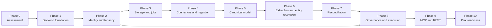

# Atlas — Phased Implementation Roadmap

**Status:** Draft v1 · execution plan for Atlas v0
**Companion document:** [`architecture.md`](./architecture.md) — the technical source of truth for design,
module ownership, data model, security and interfaces
**Audience:** Engineers and AI coding agents implementing Atlas incrementally

> This file defines **how Atlas is built**, in what order, and what "done" means for each phase.
> It does not redefine the architecture. Where this document and `architecture.md` disagree, the
> architecture document wins and the discrepancy must be corrected rather than silently followed.

---

## 1. Purpose and how to use this document

Atlas is implemented in dependency-ordered phases. Each phase is independently verifiable, leaves the
repository in a coherent state, and ends with a review gate. The roadmap is deliberately not a single
implementation plan: it is a sequence of milestones, and no milestone authorizes the next one.

Use it as follows:

1. Read `architecture.md` sections relevant to the phase before writing any code.
2. Confirm the phase's prerequisites are genuinely met.
3. Break the phase into bounded tasks (Rule 3 in Section 3).
4. Implement, test and verify each task.
5. Update the status table only after verification against acceptance criteria.
6. Report results and stop at the phase boundary (Rule 6). Do not continue without explicit direction.

Architectural decisions referenced as `ADR-00N` are defined in
`architecture.md` → **Open Architectural Decisions**. Phases that depend on an unresolved ADR say so
explicitly; work proceeds against the documented provisional default and the ADR is finalized at the stated
milestone.

---

## 2. Implementation status

Status values: **Not started**, **In progress**, **Blocked**, **Under review**, **Completed**.

> Completion requires implementation **and** verification against the phase's acceptance criteria. Existing
> documentation, scaffolding or partial code does not count as completion.

| Phase | Scope | Dependencies | Status | Exit criteria (summary) |
|---|---|---|---|---|
| 0 | Repository assessment and planning | None | Completed | Existing work understood and preserved; boundaries and ADRs documented |
| 1 | Backend foundation | Phase 0 | Completed | Go service, Chi, pgx/sqlc, migrations, config, health, tests all work |
| 2 | Identity, tenancy and security foundation | Phase 1 | Completed | Four principal classes; trusted org context; RLS; cross-tenant access rejected; WorkOS AuthKit E2E passed |
| 3 | Storage and asynchronous processing | Phase 2 | Completed | Secure document storage; durable, retryable, idempotent job execution |
| 4 | Connector framework and ingestion | Phase 3 | Completed | Source records ingested with lineage; connectors isolated from canonical logic |
| 5 | Canonical data model and ontology | Phase 4 | Completed | Canonical entities, many-to-many relationships and source links verified |
| 6 | Document extraction and entity resolution | Phases 4–5 | In progress | Validated extraction; evidence-backed entity links; no silent merges |
| 7 | Invoice reconciliation engine | Phases 5–6 | Not started | Deterministic, versioned, explainable two- and three-way reconciliation |
| 8 | Governance and execution | Phases 2, 5, 7 | Not started | Central policy, approvals, idempotent execution, full audit attribution |
| 9 | MCP and REST interfaces | Phases 7–8 | Not started | External agent can authenticate, discover, reconcile and act within policy |
| 10 | End-to-end integration and pilot | Phase 9 + ADR-003 + ADR-005 | Not started | Controlled pilot with real connector, real documents and real agent usage |

**Phase 0 note:** completed when Phase 1 was explicitly authorized (2026-11-18). The assessment and
decision-register deliverables are in `architecture.md` (§2.2–2.3 and §24). No backend code existed at that
point; this phase produced documentation and boundaries only.

**Phase 1 status note (2026-11-18):** implementation and verification are complete. The phase was accepted and
marked **Completed** when Phase 2 was explicitly authorized. Evidence:

- Go 1.27.4 module (`atlas`) under `backend/` with `cmd/` entrypoints and the `internal/` package layout. The
  Next.js application stays at the repository root; this is packaging, not a service boundary. The dependency
  rule is documented in `architecture.md` §6.3 and enforced by a static test.
- Chi router with request ID, structured request logging, panic recovery, timeout and JSON problem responses.
- pgx connection pool with startup verification; typed configuration with validation; `slog` JSON logging.
- Advisory-locked, checksum-verified migration runner plus `atlas-migrate up|down|status`; baseline
  migration and down migration both verified. Migrations are ordered numerically (a test proves `10` runs
  after `2`).
- sqlc 1.30.0 generation is reproducible; generated package committed under
  `backend/internal/platform/db/gen`. The schema input remains the Phase 1 baseline temporarily and must be
  replaced by the canonical schema in Phase 5.
- `/healthz` (liveness) and `/readyz` (database + zero pending migrations) verified, including unavailable
  database and pending-migration failure paths.
- Tests: unit tests for config, problem mapping, migration parsing/ordering and module boundaries; integration
  tests against disposable PostgreSQL 16 for migration lifecycle, SQL queries, HTTP handlers, the real
  `atlas-api` binary, and the migration CLI. A parity test asserts PostgreSQL 16.x locally and in CI. Full
  suite passes (integration ≈73s); `gofmt` and `go vet` clean; sqlc regeneration produces no diff.
- Portable verification scripts (`backend/scripts/check.ps1`, `backend/scripts/check.sh`) resolve tools from
  `PATH` and contain no machine-specific paths; the PowerShell script was executed successfully.
- CI workflow (`.github/workflows/backend.yml`) uses `backend/` as its working directory and runs formatting,
  vet, sqlc reproducibility, build and race-enabled tests against PostgreSQL 16.

Decisions applied after implementation review (2026-11-18): Go backend relocated to `backend/`; sqlc baseline
retained temporarily with a Phase 5 upgrade requirement; embedded PostgreSQL and CI PostgreSQL 16 retained with
major-version parity verified; race detector mandatory in Linux CI and optional on Windows; user-local Go
toolchain retained with versions documented and scripts PATH-based; no business handlers introduced.

Follow-up for review: confirm the Phase 1 acceptance criteria and the temporary choices recorded in
`architecture.md` §26.2; Phase 2 remains unauthorized until explicitly approved.

### Status update rules

- Only the person or agent that ran the verification may update a status.
- A phase moves to **Under review** when deliverables are complete and tests pass; it moves to **Completed**
  only after review against exit criteria.
- Any change to a phase's scope, ordering or exit criteria is recorded in this file, with the reason.
- If a phase is blocked, record the blocker, the ADR or dependency involved, and what would unblock it.

---

## 3. How implementation must be executed

These rules apply to every phase and every task. They exist because "build the architecture" is not a valid
instruction; incremental, verified progress is.

### Rule 1 — One phase at a time

Do not attempt to implement the entire architecture in one session. Work only on the currently authorized
phase. Do not silently start subsequent phases because their components appear useful. If work from a later
phase is genuinely required to make the current phase testable, stop and raise it as a scope question instead
of expanding silently.

### Rule 2 — Inspect before modifying

Before each phase:

- inspect the relevant existing code and configuration;
- understand the current architecture and how it is exercised;
- identify reusable code instead of duplicating it;
- identify affected modules and their boundaries;
- identify dependencies and unresolved ADRs;
- present a concise implementation plan before writing code.

Do not blindly generate files or duplicate functionality that already exists. The repository's existing
Next.js frontend and demo behaviour are assets; preserve them unless a phase explicitly replaces a boundary.

### Rule 3 — Define a bounded implementation scope

Break each phase into smaller implementation tasks. Each task states:

- a specific objective;
- the limited set of modules and files affected;
- the expected code changes and migrations;
- the required tests;
- a verifiable result.

Avoid enormous, ambiguous tasks such as "implement security" or "build connectors". If a task cannot be
verified in isolation, split it.

### Rule 4 — Implement and verify

After each task:

- run the relevant tests and record actual results;
- check compilation and type safety (Go vet/build, and the frontend's TypeScript checks where touched);
- validate database migrations apply and roll forward/back as designed;
- check the security invariants relevant to the task (organization context, RLS, authorization);
- review the resulting code for module-boundary violations;
- update documentation where behaviour or contracts changed.

Do not report success when tests have not actually passed. "Should work" is not a test result.

### Rule 5 — Respect module ownership

- **Go** owns canonical domain logic, authorization and policy decisions, reconciliation and canonical writes.
- **Python workers** perform specialized background processing and return validated results through the job
  result contract. They never write canonical business records.
- **MCP and REST** expose application services. They do not independently implement business logic or
  permissions.
- **Connectors** retrieve and translate external data and execute permitted writes. They do not decide
  canonical business meaning, resolve entities or reconcile.

A change that moves responsibility across these boundaries is an architectural change and requires Rule 8.

### Rule 6 — Stop at phase boundaries

When a phase is complete:

- report what was implemented;
- report files created or modified and migrations added;
- report tests executed and their actual results;
- identify unresolved issues, risks and follow-ups;
- compare the result against acceptance and exit criteria;
- update the implementation status table and any affected documentation;
- stop.

Do not proceed to the next phase until the user explicitly directs continuation.

### Rule 7 — Do not prematurely introduce infrastructure

Do not add:

- microservices or network-separated domain services;
- Kubernetes;
- dedicated message brokers (Redis as a queue, RabbitMQ, NATS, Kafka);
- graph databases;
- vector databases;
- additional implementation languages or runtimes;
- additional infrastructure providers.

Unless a concrete requirement justifies them **and** `architecture.md`'s decision register is updated to
record the change. "It might scale later" is not a requirement.

### Rule 8 — Keep the architecture documentation current

When implementation reveals a necessary architectural change:

- explain the reason and the evidence;
- identify the affected decision (ADR) or module;
- update the relevant ADR with status, consequences and date;
- update `architecture.md` and this roadmap consistently;
- preserve a clear record of what changed and why.

Do not silently deviate from the architecture. Silent deviation is the failure mode this document exists to
prevent.

---

## 4. Phase execution checklist

**At the start of a phase**

- [ ] Read the phase entry and its referenced architecture sections.
- [ ] Confirm prerequisites and unresolved-ADR status.
- [ ] Inspect existing code and tests in the affected modules.
- [ ] Produce a task breakdown with verification steps.
- [ ] Confirm nothing outside the phase will be changed.

**Per task**

- [ ] Implement the smallest coherent change.
- [ ] Add or update tests that fail without the change.
- [ ] Run the relevant test suites and record results.
- [ ] Verify migrations and security invariants.
- [ ] Review module boundaries and error handling.

**At the end of a phase**

- [ ] All acceptance criteria demonstrably met.
- [ ] `roadmap.md` status updated (and only then).
- [ ] Documentation and ADR statuses updated where decisions were made.
- [ ] Deferred work and risks recorded.
- [ ] Phase report produced (Section 7 template).
- [ ] Stop and await explicit authorization for the next phase.

---

## 5. Phase dependency model

The graph is a dependency view, not a schedule. A phase may only start when every inbound dependency has met
its exit criteria. Phase 8 depends on Phase 2 for principals and scopes and on Phase 7 for the resources it
governs. Phase 9 depends on both Phase 7 and Phase 8 because agent-facing tools must return Atlas-produced
reconciliation results and enforce governance.

---

## 6. Phase details

### Phase 0 — Repository assessment and planning

**Objective:** Confirm what exists, map it to the target architecture, and lock the execution boundaries
before any backend implementation.

**Prerequisites:** None.

**Implementation tasks:**

- Inspect the existing Next.js application: routes, components, server actions, API route handlers, read
  models and design system.
- Inspect the Prisma schema, SQLite usage, migrations, seed data and the TypeScript domain modules
  (`policy.ts`, `workflow.ts`, `agent.ts`, `queries.ts`, `audit.ts`, `session.ts`).
- Record dependencies, scripts, environment configuration and build tooling.
- Map each existing artifact to the target module set (architecture §2.3) and classify it as *keep*,
  *replace*, *reference only* or *retire*.
- Identify missing modules, architectural conflicts and reusable assets (especially UI components and the
  seeded business scenarios).
- Establish the ADR register (ADR-001 … ADR-010) and list blocking decisions.
- Produce the first task breakdown for Phase 1.

**Modules affected:** None (documentation and planning only); the frontend is inspected, not modified.

**Expected deliverables:**

- Repository assessment and existing-versus-target mapping (recorded in `architecture.md` §2.2–2.3 and this
  phase's report).
- ADR register with statuses, provisional defaults and decision milestones (`architecture.md` §24).
- Phase 1 task plan and confirmed module dependency rules.

**Testing requirements:**

- Not a test-bearing phase. Verification is documentary: every architectural claim about existing code must be
  checkable against the repository; no unimplemented capability may be described as present.

**Acceptance criteria:**

- Every existing module and data model is accounted for in the mapping.
- The frontend preservation strategy and the SQLite/Prisma disposition are explicit.
- All ten open decisions are documented with provisional defaults.
- Phase 1's scope is specific enough to start without re-analysis.

**Exit criteria:**

- Engineering review agrees on module boundaries, data ownership and the frontend/backend contract.
- Blocking decisions are identified; none blocks Phase 1.
- Status is updated to Completed once engineering sign-off is recorded (currently Under review).

**Explicitly deferred:**

- Any code migration, scaffolding or dependency change.
- Backend creation and infrastructure provisioning.

**Risks and unresolved decisions:**

- Risk: treating prototype behaviour as production truth. Mitigation: the mapping table distinguishes the
  simulated agent, mock ERP write-back and cookie role switcher from target behaviour.
- Risk: scope creep into frontend redesign. Mitigation: the UI is preserved; only its data access changes,
  later.
- ADRs influencing this phase: ADR-001, ADR-002, ADR-003, ADR-004 (none finalized; provisional defaults
  recorded).

---

### Phase 1 — Backend foundation

**Objective:** A runnable Go backend skeleton with enforced structure, database access, migrations and
quality gates.

**Prerequisites:** Phase 0 exit criteria met.

**Implementation tasks:**

- Create the Go module under `backend/` (separate from the Next.js application at the repository root) and the
  `cmd/` entrypoints (`atlas-api`; stubs for `atlas-mcp`, `atlas-worker`, `atlas-scheduler` that start and exit
  cleanly).
- Create the `internal/` package layout from architecture §6.3, with an explicit dependency rule document and
  a static test that `internal/` never imports `cmd/` and that transport packages are only imported by
  transport code.
- Configure Chi with middleware order: request ID → structured logging/recovery → timeout → handler.
- Configure pgx connection pooling against PostgreSQL; add startup connectivity verification and timeouts.
- Add sqlc configuration, one sample query, generated code committed and reproducible. The baseline schema is a
  temporary Phase 1 input; it is replaced by the canonical schema in Phase 5.
- Add the migration runner: numerically ordered SQL files, advisory lock, checksum verification,
  `schema_migrations` tracking, and explicit up/down verification in tests.
- Define typed configuration loading with validation; define structured JSON logging with level and service
  fields; define domain error types and the transport problem-document mapping.
- Add `/healthz` and `/readyz`; readiness checks database connectivity and migration state.
- Establish the test harness: unit tests, PostgreSQL-backed integration tests, a real-binary smoke test, and
  portable verification scripts (`backend/scripts/check.ps1`, `backend/scripts/check.sh`) that resolve tools
  from `PATH`.
- Add CI: build, vet, race-enabled tests with a PostgreSQL 16 service, migration checks and sqlc drift check.

**Modules affected:** `platform`, `httpapi` (skeleton), database/migrations infrastructure, test harness.

**Expected deliverables:**

- Runnable API process with health endpoints.
- Database connectivity and migration framework.
- Configuration, logging, errors and test conventions documented in the repository.
- CI pipeline executing the quality gates.

**Testing requirements:**

- Unit tests for configuration validation, error mapping, migration parsing and numeric ordering, and module
  boundaries.
- Integration tests proving migrations apply in numeric order, checksums are enforced, constraints work and
  `readyz` reflects schema state.
- A test asserting the PostgreSQL major version is 16.x locally and in CI.
- CI runs the full suite against a real PostgreSQL 16 instance, not SQLite, with the race detector enabled.

**Acceptance criteria:**

- `atlas-api` starts with valid config and fails fast with invalid config.
- Migrations apply repeatedly and safely; advisory lock prevents concurrent runs.
- `/healthz` and `/readyz` behave correctly under database outage and pending migrations.
- sqlc generation is reproducible in CI (no uncommitted diff).
- All tests pass in CI from a clean checkout.

**Exit criteria:**

- Acceptance criteria met and reviewed.
- Module boundaries and dependency rules documented and enforced.
- Phase 2 plan prepared.

**Explicitly deferred:**

- Business tables, authentication, tenancy, storage, queue semantics, domain modules, business handlers.
- The complete canonical schema for sqlc (Phase 5); the Phase 1 baseline is temporary.

**Risks and unresolved decisions:**

- Risk: package-boundary erosion under time pressure. Mitigation: CI import check plus review.
- Risk: migration discipline drift. Mitigation: up/down tests and expand/contract convention documented now.
- Recommended, not accepted: UUIDv7 primary keys (adopt in Phase 2 schema; recorded in architecture §25).
- ADR-004 is not required yet; workload identity is deferred to Phase 2 interfaces and Phase 10 finalization.

---

### Phase 2 — Identity, tenancy and security foundation

**Objective:** Every request and job operates under a verified principal and a trusted organization context,
with database-enforced tenant isolation.

**Prerequisites:** Phase 1 accepted.

**Implementation tasks:**

- Define the four principal kinds in code: human user, external agent connection, integration, and Atlas
  workload. Each has a distinct identifier type and attribution fields.
- Create schema: `organizations`, `users`, `memberships`, `agent_connections`, `agent_scopes`,
  `integrations` (metadata only), sessions and audit events. Roles are constrained values on memberships in
  v0 rather than a separate roles table.
- Implement organization membership and role assignment services (admin, member) with permission mapping.
  `actions.approve` / `actions.reject` are explicit permissions granted later to eligible members; there is no
  human `actions.execute` permission.
- Define the `identity.Authenticator` interface; implement opaque, DB-backed development sessions behind it
  now. The managed OIDC adapter remains pending ADR-002. Sessions are server-side; the demo cookie role
  switcher is confined to explicit development flags.
- Implement the authorization service: principal + organization + action + resource → allow/deny, default deny,
  with typed reason codes and recorded decisions.
- Implement organization context propagation: middleware resolves principal → organization; services reject
  missing context; jobs carry organization in their payload and set it explicitly.
- Enable RLS on tenant tables; provision `atlas_app` (runtime), `atlas_migrator` (schema owner) and
  `atlas_worker` (background) roles with least privilege; set `app.organization_id` per transaction with
  `set_config`. Runtime roles must be non-owners and must not bypass RLS.
- Separate identity/session access into an `atlas_auth` role; the tenant runtime role must not read `users` or
  `sessions` directly. Member listing uses a narrowly scoped security-definer function.
- Execute the actual role-provisioning SQL in integration tests and CI, and assert role attributes, ownership
  and privilege boundaries rather than recreating grants programmatically.
- Define workload identity interfaces (token issuance/verification boundary) without committing to ADR-004's
  mechanism.
- Add audit attribution fields to the audit writer interface (actor, principal kind, workload, organization).

**Modules affected:** `identity`, `tenancy`, `orgs`, `agentaccess`, `integrations` (principal metadata),
`audit`, `platform`, `httpapi` middleware, migrations.

**Expected deliverables:**

- Identity and tenancy schema and migrations.
- `identity.Authenticator` interface with a development session provider; managed OIDC adapter pending
  ADR-002.
- Authorization service and middleware used by every handler.
- RLS policies and role setup with a documented runbook.
- Agent and integration principal records (no agent OAuth grant yet).
- Security test suite for tenancy and authorization.

**Testing requirements:**

- Integration tests with two organizations: reads and writes cannot cross the boundary at the service layer or
  through direct SQL under the app role.
- RLS tests proving a query missing an explicit filter still returns only the active organization's rows.
- Authorization tests: default deny; role capability matrix; non-human principals denied until scopes are
  enforced in Phase 9.
- Context tests: missing organization context fails closed; tampered organization ID is rejected.
- Database role tests: the app role cannot update/delete audit rows and cannot bypass RLS.

**Acceptance criteria:**

- Every request resolves a principal and organization; unauthenticated access is rejected.
- Cross-organization access fails at application and database layers.
- Development authentication cannot be enabled in staging or production configuration.
- Audit rows capture initiating principal and organization.
- Database roles follow least privilege and are exercised in tests.

**Exit criteria:**

- Acceptance criteria met and reviewed.
- ADR-002 status updated (selected or explicitly deferred with a dated provisional default).
- Production authentication implemented and tested (managed OIDC); until then this phase cannot be Completed.
- Phase 3 plan prepared.

**Explicitly deferred:**

- Agent OAuth authorization flow and token scopes (Phase 9).
- Production IdP hardening, enterprise SSO and SCIM.
- Concrete workload identity provider (ADR-004) and production credential issuance.

**Risks and unresolved decisions:**

- Risk: RLS bypass through table ownership or superuser roles. Mitigation: separate owner/migrator role;
  tests run as the app role.
- Risk: connection pooling leaking `SET LOCAL` context. Mitigation: always set inside the same transaction;
  integration test with concurrent tenants.
- ADR-002 (identity provider) — interface locked here; final vendor before production auth.
- ADR-004 (workload identity) — interfaces only; final mechanism before production.

**Phase 2 status note (2026-11-18, completed 2026-11-21):** implementation and verification are complete.
Phase 2.1 resolved the managed-OIDC blocker and the WorkOS AuthKit sandbox E2E passed, so the phase was
accepted and marked **Completed** on 2026-11-21.
Evidence:

- Migrations `0002_identity_tenancy` and `0003_security_hardening` create organizations, users, memberships,
  sessions, agent connections/scopes, integrations, append-only audit events, and RLS policies. Human roles are
  the two built-in roles `admin` and `member`.
- Four principal categories are modelled; human sessions are implemented. Agent and integration authentication
  are intentionally deferred to Phase 9, and workload identity is an interface only (ADR-004).
- `identity.Authenticator` separates the production seam from `DevSessionIssuer`; dev login is rejected in
  staging/production, is absent when disabled, and `atlas-api` refuses to serve in production until managed OIDC
  exists. Session expiry and logout revocation are covered by tests.
- RBAC (admin/member) is centralized in `internal/authorization`; non-human principals are denied by default.
  `/v1/members` requires `members:read`; `/v1/organization/settings` requires `organization:manage`.
  `actions.approve`/`actions.reject` exist as explicit permissions but are not granted by role in Phase 2.
- Database privileges separate paths: `atlas_app` has no direct `users`/`sessions` access (member listing uses
  the `atlas_list_members()` security-definer function restricted to the current organization), `atlas_auth`
  handles identity/session operations, `atlas_worker` has tenant DML without identity tables, and
  `atlas_migrator` owns schema objects. All roles are `NOSUPERUSER NOBYPASSRLS`.
- The real provisioning SQL (`scripts/provision-app-role.sql`) is executed by the integration suite before every
  tenant test and in CI, not re-created programmatically. Tests assert role attributes, ownership, privilege
  boundaries, missing-context behavior, cross-tenant reads/writes and concurrent pool reuse.
- Audit login/logout events record organization, actor kind, actor id, display name and decision. Runtime roles
  cannot update or delete audit rows.
- Full backend suite passes, including Phase 1 regression and the identity, RBAC, RLS, audit, expiry,
  concurrency, provisioning-SQL and privilege-boundary tests. `gofmt`/`go vet` clean.
- **Managed OIDC vendor direction (2026-11-18):** lean **WorkOS (AuthKit)**, provisionally recorded in
  ADR-002 (fallback: Auth0 if the Phase 9 MCP token model cannot be validated on WorkOS).
- **Sandbox verified (2026-11-19):** WorkOS Staging sandbox is configured — AuthKit app "Atlas Sandbox",
  redirect URI `http://localhost:8080/v1/auth/oidc/callback` registered as default, one verified end user
  (Google sign-in). WorkOS MCP OAuth mechanics work (signin.workos.com, S256 PKCE, refresh tokens). Remaining
  setup: demo SSO connection and SCIM directory must be created in the WorkOS dashboard/API (MCP does not
  expose connection creation; `createDirectory` is feature-gated). Phase 2.1 can proceed against the sandbox;
  production serving stays refused until the E2E passes.
- No business handlers were added. That is intentional and does not violate Phase 2 exit criteria; health and
  readiness plus identity/tenancy endpoints are the intended Phase 2 surface.

ADR-002 is Accepted, the production OIDC path is implemented and tested, and the phase acceptance criteria
were reviewed; Phase 2 was marked **Completed** on 2026-11-21. Phase 3 must not start without explicit
authorization.

#### Phase 2.1 — Production authentication (completed 2026-11-21)

A focused follow-up to Phase 2 that resolves the human-authentication blocker. It requires an explicit
go-ahead plus WorkOS sandbox credentials, and must not start silently.

**Objective:** Replace the development-only session issuer with a production WorkOS-backed
`identity.Authenticator`, implementing the identity-linking policy recorded in `architecture.md` (ADR-002).

**Planned tasks:**

- Provision the WorkOS sandbox environment: issuer URL, client ID/secret, redirect URIs
  (`/v1/auth/oidc/callback`), test users with MFA.
- Migration: `oidc_identities` (unique `issuer, subject` → `user_id`) and `organization_invitations`
  (organization, email, token hash, role, expiry, consumed state).
- WorkOS adapter behind `identity.Authenticator`: authorization code + PKCE, `state`/`nonce` validation,
  ID-token signature/claim validation via JWKS, JIT user creation — membership only through accepted
  invitations; invitation acceptance requires `email_verified`, a valid unexpired token and an email match.
- Explicit account-linking flow (authenticated Atlas session + fresh OIDC authentication + confirmation +
  audit); no silent identity merges; multi-organization chooser after login.
- Session mapping into the existing opaque-session model; logout revokes the Atlas session only.
- Keep dev sessions dev/test-only; retire the dev-login route in production builds entirely.
- Validation spike: confirm AuthKit token issuance/JWKS behaviour for the Phase 9 MCP resource-server model;
  record the result in ADR-002 (fallback Auth0 if it cannot be reconciled).
- WorkOS MCP server (`mcp.workos.com/mcp`) is configured in the project for sandbox management: the coding
  agent can provision and inspect the WorkOS staging environment (AuthKit settings, test users, demo
  SSO/directory connections) on request, under the dashboard account's permissions (sandbox-scoped by
  default, destructive actions confirmed, secrets stripped from responses).
- Tests: adapter unit tests against a local mock issuer; sandbox E2E for login, logout, expiry, revocation,
  invitation acceptance, linking; only then lift `Config.ValidateServing`'s production gate.

**Acceptance criteria (met 2026-11-21):** a human can complete a real WorkOS login and land in an Atlas
organization via invitation; linking and invitation rules are enforced and audited; production serving is
enabled only after sandbox E2E passes; ADR-002 is Accepted with date and evidence.

**Implementation status (2026-11-19, completed 2026-11-21):** core implemented and mock-tested — sealed OIDC state, AuthKit
server-side code exchange, JIT users, invitation acceptance, explicit linking, OIDC session issuance,
`oidc_identities` + `organization_invitations` migrations, admin invitation endpoint, and the
`OIDC_PRODUCTION_VERIFIED` production gate. **Remaining:** the real WorkOS sandbox browser E2E (login as the
verified sandbox user), WorkOS Demo SSO/SCIM connection creation in the dashboard, and then flipping
`OIDC_PRODUCTION_VERIFIED` + recording ADR-002 as Accepted. Phase 2 stays **Under review** until then.

**Deferred:** enterprise SSO connections and SCIM directory sync for real customers (added when justified);
agent OAuth flows (Phase 9).

---

### Phase 3 — Storage and asynchronous processing

**Objective:** Secure document storage and a durable, leased, retryable job system with safe duplicate
execution.

**Prerequisites:** Phase 2 accepted.

**Implementation tasks:**

- Implement an object-storage abstraction over the R2 S3-compatible API (presign upload, presign download,
  head, delete, checksum read) with a local development adapter.
- Create document schema: `documents`, `document_versions`, ownership, kind, content type, size, SHA-256,
  storage key, status, retention class.
- Implement the upload lifecycle: authorize → server-chosen key → presigned PUT → finalize → checksum and size
  verification → availability transition. Reject unsupported types and oversize files.
- Implement download/preview authorization and short-lived presigned GET issuance.
- Create job schema: `jobs`, `job_attempts`, `job_results`, `outbox_events`, with organization, type, payload,
  status, priority, run_at, attempts, lease fields and idempotency key.
- Implement the queue interface and the PostgreSQL claim query using `FOR UPDATE SKIP LOCKED`; add lease
  expiry recovery, exponential backoff with jitter, maximum attempts, dead-letter transitions and requeue.
- Implement typed job and result contracts with `schema_version`; validate payloads on enqueue and on claim.
- Implement the outbox dispatcher: publish pending rows to jobs/webhooks, mark published, record attempts.
- Create the Go worker entrypoint (claim loop, graceful shutdown, heartbeat/lease renewal where needed) and the
  Python worker skeleton that claims a job, writes a result payload, and never writes canonical tables.
- Add queue and storage metrics and trace propagation through job payloads.

**Modules affected:** `documents`, `jobs`, `events` (outbox), `platform` (storage, telemetry), `contracts`,
`cmd/atlas-worker`, `cmd/atlas-scheduler`, Python runtime skeleton.

**Expected deliverables:**

- Working private document upload/download with verification.
- Document metadata and versioning.
- Durable job queue with leasing, retries, dead-letter and idempotency.
- Go and Python worker entrypoints with a validated result contract.
- Outbox dispatch mechanism.

**Testing requirements:**

- Upload tests: valid/invalid type, oversize, checksum mismatch quarantine, unauthorized presign refusal.
- Queue tests: concurrent claims do not duplicate; lease expiry returns a job to pending; retry backoff and
  max attempts; dead-letter and requeue; duplicate idempotency key behavior.
- Crash tests: terminate a worker mid-job and prove recovery by another worker.
- Outbox tests: a business transaction and its outbox row commit atomically; dispatcher is idempotent.
- Security tests: presigned URLs are scoped and short-lived; storage keys cannot be chosen by clients.

**Acceptance criteria:**

- Files upload and download only through authorized flows and pass integrity checks.
- Jobs survive worker crashes; duplicate execution is detected or harmless by contract.
- Python results are recorded as job results, never canonical rows.
- Queue state is observable by status and type.

**Exit criteria:**

- Acceptance criteria met and reviewed.
- Lease/retry defaults documented per job type.
- Phase 4 plan prepared.

**Explicitly deferred:**

- Real connector jobs, extraction content, reconciliation jobs, webhook subscriptions beyond the basic
  dispatcher.
- Production R2 bucket topology and lifecycle rules (ADR-007 dependent).

**Risks and unresolved decisions:**

- Risk: at-least-once semantics misunderstood by handlers. Mitigation: idempotency contract enforced in code
  review and tests per job type.
- Risk: local storage adapter diverging from R2 behaviour. Mitigation: contract tests run against both where
  possible.
- ADR-007 (retention) affects document lifecycle but not this phase's mechanics.

**Implementation status (2026-11-21):** implementation and verification complete; phase is **Under review**.
Migration `0005_jobs_outbox` adds `jobs`, `job_attempts`, `job_results` and `outbox_events` with RLS, lease/claim
support via `atlas_claim_job`/`atlas_reap_expired_leases`/`atlas_claim_outbox` security-definer functions.
`internal/jobs` implements transactional enqueue with idempotency keys, leased claims (`FOR UPDATE SKIP
LOCKED`), completion and results, retry backoff with jitter, dead-letter/requeue, lease reaping and outbox
dispatch. `cmd/atlas-worker` and `cmd/atlas-scheduler` are implemented. Migration `0006_documents` adds
documents and immutable versions; `internal/storage` provides local and S3/R2 adapters; the authorized
upload/finalize/download lifecycle is live under `/v1/documents`; `python/atlas_worker.py` is the result-only
Python skeleton. Tests cover lifecycle/idempotency, concurrent claims, lease recovery, outbox atomicity, and
document upload/integrity/quarantine. Handling later: contract tests against a real R2
bucket, queue metrics/trace propagation, and per-type lease/retry defaults documentation.

---

### Phase 4 — Connector framework and ingestion

**Objective:** External and document-source data enters Atlas as immutable source records with lineage, through
a shared connector contract, without touching canonical business logic.

**Prerequisites:** Phase 3 accepted.

**Implementation tasks:**

- Define the connector contract (pseudocode in architecture §11.1) and the adapter registry.
- Implement connector execution through the shared Go worker: validate connection, discover capabilities, sync
  pages, fetch documents, execute permitted writes (write path stubbed until Phase 8).
- Implement integration metadata schema and encrypted credential storage using the platform secret mechanism;
  key rotation hooks.
- Implement sync runs, cursors, page limits, rate-limit handling, retry classification and connection health
  states.
- Implement the mock connector with deterministic fixtures covering suppliers, POs, delivery records and
  invoices.
- Implement the document-inbox connector: authenticated upload (and SFTP/email ingestion stubs behind the same
  contract) producing source records and document records.
- Create the source-record schema and ingestion orchestration: persist raw payload, checksum, provider
  identifiers, received timestamp, batch reference.
- Implement the normalization pipeline skeleton with versioned mappings producing typed normalized records;
  wire provenance rows for each transformation.
- Implement webhook receiving for connectors that support it: signature verification, timestamp tolerance,
  dedupe by external event ID, raw persistence and targeted sync enqueue.
- Ensure adapters cannot write canonical tables (dependency rule + code review).

**Modules affected:** `connectors`, `integrations`, `ingestion`, `normalization`, `documents`,
`provenance`, `jobs`, `events`, `contracts`.

**Expected deliverables:**

- Connector contract, registry and lifecycle.
- Integration and credential management.
- Mock connector and document-inbox connector.
- Source-record and normalized-record persistence with lineage.
- Sync history, cursor handling and health reporting.

**Testing requirements:**

- Connector contract tests against recorded fixtures (pagination, empty pages, 429, 5xx, token refresh).
- Sync idempotency: repeated syncs do not duplicate source records; cursors advance correctly.
- Webhook tests: signature failure rejected, duplicate event deduped, out-of-window timestamp rejected.
- Ingestion tests: raw payload preserved byte-for-byte; checksums match; normalization mapping version recorded.
- Boundary test: connector packages have no import path to canonical repositories.

**Acceptance criteria:**

- Sample supplier, PO, delivery and invoice data ingest from the mock connector and document inbox.
- Source identifiers and raw payloads are preserved and traceable.
- Normalization produces typed records with a recorded mapping version.
- Connectors contain no canonical business decisions.

**Exit criteria:**

- Acceptance criteria met and reviewed.
- ADR-003 recorded as open or decided; the mock/inbox path is sufficient to proceed.
- Phase 5 plan prepared.

**Explicitly deferred:**

- Real ERP/accounting connector implementation (ADR-003).
- Canonical projection (Phase 5).
- Extraction (Phase 6) and write-back execution (Phase 8).

**Risks and unresolved decisions:**

- ADR-003 (first connector) — not required for this phase; mock and inbox connectors are in scope.
- Risk: credential-encryption scope creep. Mitigation: use the platform secret boundary established in
  Phase 1 and keep key management out of domain code.
- Risk: provider rate-limit behaviour unknown. Mitigation: framework-level backoff and observable metrics.

**Implementation status (2026-11-21, complete; under review):** migration `0007_connectors` and the core ingestion
path are implemented: `internal/connectors` (contract + registry + deterministic mock + document-inbox adapter),
envelope-encrypted credentials (`internal/secrets`), `internal/ingestion` (validated sync, idempotent raw source
records with SHA-256, versioned normalization `mock-v1`, provenance, cursors, sync runs, health), and the
worker's `connector.sync` handler. Management endpoints (`/v1/integrations`, credentials, sync trigger), webhook
receiving (HMAC signature, 5-minute timestamp window, dedupe by event id, raw persistence, targeted sync),
document-inbox ingestion on finalize, mock fixtures for 429/5xx and credential validation, and the connector
boundary test are implemented. Tests cover pagination/empty pages, sync idempotency (repeat syncs write zero
duplicates), cursor advancement, raw-payload checksum preservation, encrypted credential storage, webhook
verification/dedupe, and the import boundary. **Handling later:** provider-specific rate-limit retry and
token-refresh orchestration against real systems.

---

### Phase 5 — Canonical data model and ontology

**Objective:** Atlas has an explicit, relational canonical model for the invoice-reconciliation domain, with
ontology versioning, many-to-many relationships and source traceability.

**Prerequisites:** Phase 4 accepted (source records exist and can be normalized).

**Implementation tasks:**

- Create canonical tables and constraints: suppliers, invoices, invoice lines, purchase orders, PO lines,
  delivery records, delivery lines, documents linkage, source records, source-to-entity links.
- Model relationships explicitly, including invoice↔PO many-to-many (`invoice_po_links`), delivery-to-PO-line
  fulfillment, and line-level associations required for allocation.
- Enforce money as integer minor units plus ISO-4217 currency; quantities as `numeric(18,6)` with unit
  references; business references unique per organization.
- Implement ontology version 1: entity/relationship definitions, version table, validation hook used on
  canonical writes.
- Implement canonical repositories with org scoping and RLS; prohibit cross-module table access.
- Implement source-to-entity link records with method, confidence and evidence fields (population of links by
  entity resolution arrives in Phase 6).
- Build canonical projection from normalized records behind an explicit service boundary; record provenance
  for each projection.
- Add read models required by the UI for invoice/PO/delivery/supplier detail (sufficient for later phases).
- Convert representative prototype seed scenarios into canonical fixtures with known expected structure.
- Replace the temporary Phase 1 sqlc schema input (the baseline migration) with the complete canonical schema,
  and verify generated queries still reproduce with no diff.

**Modules affected:** `canonical`, `ontology`, `provenance`, `query`, migrations, `ingestion`
(projection trigger only).

**Expected deliverables:**

- Canonical schema with constraints, indexes and RLS.
- Ontology v1 and version recording.
- Canonical write and read services.
- Fixture corpus representing the reconciliation scenarios.
- Source traceability from canonical rows to normalized and source records.

**Testing requirements:**

- Constraint tests: money precision, quantity scale, currency integrity, composite tenant keys.
- Relationship tests: one invoice to multiple POs; multiple invoices per PO; partial deliveries across
  separate delivery records; split invoices.
- RLS tests on every canonical table.
- Traceability tests: every canonical entity resolves to at least one source link/fixture origin.
- Migration tests: up/down and expand/contract compatibility.

**Acceptance criteria:**

- Representative fixtures are represented without lossy simplifications.
- Many-to-many and partial-delivery relationships work in queries.
- Canonical writes are org-scoped and ontology-versioned.
- Read models support the existing UI's information requirements.

**Exit criteria:**

- Acceptance criteria met and reviewed.
- Ontology v1 frozen for reconciliation work; changes thereafter require version bumps.
- Phase 6 plan prepared.

**Explicitly deferred:**

- Entity resolution and automatic linking (Phase 6).
- Reconciliation (Phase 7).
- Any UI redesign or workflow changes.

**Risks and unresolved decisions:**

- Risk: over-modelling for hypothetical workflows. Mitigation: implement only v0 entities; extension points
  documented in architecture §12.4.
- Risk: premature generic ontology interpretation. Mitigation: compiled validation, no runtime schema engine.
- ADR-008 (FX/UoM) interfaces are stubbed here but not implemented; recorded so Phase 7 can use them.

**Implementation status (2026-11-21, in progress):** migration `0009_canonical` and ontology v1 are implemented
with the core canonical tables, composite tenant keys, currency/money/quantity constraints, invoice?PO
many-to-many links, and source-to-entity provenance links. `internal/canonical` provides org-scoped canonical
writes and ontology access. Tests cover constraints, many-to-many links, traceability and RLS. Line-level canonical writes, idempotent projection from normalized records with
provenance, invoice read models and ontology checks on canonical writes are implemented. **Handling later:**
partial deliveries and PO/supplier read models are also implemented. The JSON fixture corpus (split invoices,
partial deliveries) and fail-closed ontology validation are covered by tests. No remaining Phase 5 items.

---

### Phase 6 — Document extraction and entity resolution

**Objective:** Structured, validated extraction from documents and trustworthy, evidence-backed supplier
identity — without silent merges or hidden model authority.

**Prerequisites:** Phases 4 and 5 accepted.

**Implementation tasks:**

- Define the extraction provider interface in Python and the Go-side result contract (`schema_version`,
  fields, lines, confidence, warnings, provider metadata).
- Implement a mock extraction provider with deterministic fixtures for invoices, POs and delivery notes.
- Implement the Python worker pipeline: claim extraction job, fetch document via scoped access, run provider,
  validate output with Pydantic, write only the job result payload.
- Implement Go validation of extraction results: schema, types, money/quantity sanity, required fields,
  confidence thresholds; reject with structured reasons.
- Persist extraction drafts and confidence/evidence; do not promote directly to canonical rows without the
  documented validation gate.
- Implement entity resolution for suppliers: deterministic identifier keys, normalized identifiers, candidate
  generation (including trigram similarity), weighted scoring, evidence capture, and statuses
  (proposed/accepted/rejected/expired).
- Implement duplicate detection for invoices (reference-based and fingerprint-based) and record candidates.
- Implement reversible entity links and merge history with explicit authorization checks.
- Implement an ambiguity review surface at the API level (minimal UI is acceptable) so candidates can be
  confirmed or rejected; no auto-merge above unresolved conflicts.
- Build the extraction benchmark harness and a representative, anonymized invoice set; record accuracy,
  latency and cost metrics.

**Modules affected:** `documents`, `entityresolution`, `canonical`, `provenance`, `jobs`, `contracts`,
Python worker, `query`.

**Expected deliverables:**

- Provider-independent extraction interface with mock provider.
- Working Python extraction pipeline and validated Go gate.
- Supplier resolution with evidence, review and reversible links.
- Duplicate detection records.
- Benchmark report and provider evaluation matrix.

**Testing requirements:**

- Extraction contract tests: malformed payload rejected; confidence propagation; deterministic mock outputs.
- Validation tests: negative amounts, impossible quantities, currency mismatch, missing required fields.
- Entity resolution tests: exact identifiers auto-link; ambiguous names produce candidates with evidence; no
  silent merge on conflicting tax IDs; merge reversal restores prior state.
- Duplicate tests: same invoice number and fingerprint detection.
- Benchmark reproducibility: fixture set and expected outputs versioned.

**Acceptance criteria:**

- Representative invoices, POs and delivery notes extract into validated structured output.
- Extraction cannot write canonical rows; the Go gate is the only promotion path.
- Entity links always carry evidence and resolver version; ambiguous cases await review.
- Benchmark results exist for at least the candidate providers evaluated.

**Exit criteria:**

- Acceptance criteria met and reviewed.
- ADR-005 updated with benchmark evidence and either a selection or a dated deferral.
- Phase 7 plan prepared.

**Explicitly deferred:**

- Production extraction provider selection if benchmarks are inconclusive (mock remains for development).
- AI-assisted candidate proposals beyond document interpretation.
- Full review UI (API-level review is sufficient for v0 engineering progress).

**Risks and unresolved decisions:**

- ADR-005 (extraction provider) — provisional mock; final selection requires benchmark evidence and privacy
  review.
- ADR-008 — supplier matching does not depend on FX/UoM, but extracted currency/unit fields must be preserved
  for later normalization.
- Risk: extraction accuracy variance across layouts. Mitigation: benchmark across a diverse corpus, not a
  single invoice.

---

### Phase 7 — Invoice reconciliation engine

**Objective:** Deterministic, explainable, versioned two-way and three-way reconciliation that is Atlas's
authoritative operational result.

**Prerequisites:** Phases 5 and 6 accepted.

**Implementation tasks:**

- Implement the reconciliation orchestrator: load context (invoice, linked POs, deliveries, supplier,
  documents, organization tolerances), create a run row, enqueue execution, finalize immutably.
- Implement header matching: supplier, PO reference(s), invoice uniqueness, date plausibility, totals.
- Implement line matching: SKU/part number, normalized description, unit price proximity, and allocation
  across multiple PO lines/deliveries.
- Implement quantity reconciliation with partial-delivery aggregation and split-invoice handling.
- Implement price reconciliation with configurable percentage and absolute tolerances.
- Implement the currency conversion interface with a recorded FX snapshot per run (ADR-008 provisional
  adapter), preserving original amounts.
- Implement the unit-of-measure conversion interface with an internal catalog, explicit conversion evidence and
  `insufficient_evidence` on unsupported units (ADR-008).
- Implement duplicate detection integration and split-invoice detection.
- Implement the discrepancy taxonomy with typed codes, severity and evidence references.
- Persist versioned results: run ID, rule version, ontology version, input fingerprint, FX snapshot, matches,
  discrepancies, timestamps; maintain the invoice's current-run pointer without mutating history.
- Build read models for reconciliation results needed by REST/MCP and the UI.
- Assemble the regression corpus from fixtures with expected outputs and enforce it in CI.

**Modules affected:** `reconciliation`, `canonical`, `query`, `governance` (reading tolerance config),
`jobs`, `provenance`, `contracts`.

**Expected deliverables:**

- Working reconciliation engine with versioned runs.
- Complete discrepancy taxonomy and evidence assembly.
- Regression corpus with expected results.
- Read models for results and discrepancies.

**Testing requirements:**

- Golden corpus covering: quantity surplus/shortfall, partial deliveries, split invoices, multiple POs,
  multiple invoices per PO, price variance inside/outside tolerance, missing delivery, missing PO, duplicate
  invoice, currency difference, unit conversion, unknown unit.
- Determinism: identical inputs and rule version produce identical outputs (including ordering).
- Immutability: re-running creates a new run and leaves the prior run intact.
- Rounding and tolerance boundary tests, including exact-threshold behaviour.
- Performance sanity: representative corpus size completes within an agreed budget.

**Acceptance criteria:**

- Two-way and three-way matching produce expected results for every corpus case.
- Every result is explainable from stored matches, evidence and rule version.
- Historical runs remain retrievable and are never overwritten.
- Unknown units and missing evidence produce explicit `insufficient_evidence` outcomes.

**Exit criteria:**

- Acceptance criteria met and reviewed.
- Rule versioning policy documented; corpus expectations versioned.
- ADR-008 interface decisions recorded (providers may remain undecided).
- Phase 8 plan prepared.

**Explicitly deferred:**

- Agent-facing presentation of results (Phase 9).
- Approvals and execution gating (Phase 8).
- Additional workflows beyond invoice reconciliation.

**Risks and unresolved decisions:**

- ADR-008 (FX/UoM) — adapters required here; actual providers may be finalized later. Defaults must be
  documented and deterministic.
- Risk: rule changes silently changing historical interpretation. Mitigation: rule version in every result and
  corpus diffs in review.
- Risk: data quality from extraction. Mitigation: Phase 6 confidence and validation gate; unresolved fields
  produce review-required outcomes.

---

### Phase 8 — Governance and execution

**Objective:** Central policy decisions and safe, idempotent execution of permitted actions, with approvals
that cannot be bypassed.

**Prerequisites:** Phase 7 accepted and Phase 2 accepted.

**Implementation tasks:**

- Implement the policy engine: subject (human/agent/integration/workload), organization, resource, action,
  context → allow/deny/require_approval, with policy versions and recorded decisions.
- Implement RBAC for humans and scoped capabilities for agents; map roles and scopes to the action catalog.
- Implement the action catalog and classification: read, analytical, draft, external write; explicitly exclude
  payment execution in v0.
- Implement approvals: creation bound to resource version, reconciliation run and policy version; approver role
  resolution; decision recording; invalidation when underlying state changes.
- Implement the operation lifecycle and `operations`/`operation_attempts` tables: requested → authorized →
  pending approval → queued → executing → succeeded/failed/cancelled/expired.
- Enforce idempotency keys on action requests and propagate provider-facing idempotency where supported.
- Implement execution through connectors for permitted writes (supplier follow-up notification, permitted ERP
  status write-back) with retry classification, timeout and failure recording.
- Implement cancellation-before-execution and compensating-action recording after possible side effects.
- Wire audit attribution for every decision, approval and attempt.
- Implement execution status APIs for internal use (agent-facing exposure lands in Phase 9).

**Modules affected:** `governance`, `execution`, `connectors` (write path), `audit`, `jobs`, `identity`,
`agentaccess`, `events`.

**Expected deliverables:**

- Central policy service with versioned policies.
- Approval workflow with binding and invalidation; grant `actions.approve` / `actions.reject` explicitly to
  eligible members. Never introduce a human `actions.execute` permission.
- Operation model with idempotency, retries and status.
- Connector-backed execution for low-risk writes.
- Audit coverage for the full decision-to-outcome path.

**Testing requirements:**

- Default-deny tests across principal kinds; scope escalation attempts rejected.
- Approval bypass tests: execution without approval, approval after state change, approval across organizations.
- Idempotency: repeated requests with the same key yield one operation; conflicting payload rejected.
- Failure tests: connector timeout/4xx/5xx classification, retry bounds, dead-letter and operator requeue.
- Audit tests: every operation has decision, principal, policy version and outcome.

**Acceptance criteria:**

- Unauthorized actions are denied at the service layer, not just the transport.
- Approval-required actions cannot execute without a valid, current approval.
- Permitted actions execute reliably and idempotently, with attempts recorded.
- Every significant operation is auditable and attributable across the four principal kinds.

**Exit criteria:**

- Acceptance criteria met and reviewed.
- Policy/operation model documented and stable enough for agent exposure.
- Phase 9 plan prepared.

**Explicitly deferred:**

- Autonomous payment execution (architecture non-goal).
- Complex multi-step approval chains.
- External approval routing channels (recommended internal UI for v0; revisit after pilot).
- Agent-facing progress notifications (Phase 9).

**Risks and unresolved decisions:**

- Risk: policy engine becoming an unmaintainable rules language. Mitigation: start with typed rule functions
  and validated configuration; no DSL until required.
- Risk: approval binding complexity. Mitigation: store resource version/run hash and test invalidation
  exhaustively.
- ADR-003 affects write-back targets; connector write path is exercised with the mock connector until a real
  provider exists.

---

### Phase 9 — MCP and REST interfaces

**Objective:** External agents connect over MCP, discover Atlas capabilities, obtain Atlas-produced
reconciliation results and request governed actions; the web client consumes the same services over REST.
Atlas does not build, host or provide agents: each customer connects its own agents to these interfaces.

**Prerequisites:** Phases 7 and 8 accepted.

**Implementation tasks:**

- Implement the remote MCP server with Streamable HTTP transport, sharing application services with REST.
- Implement MCP authorization aligned with the current MCP authorization specification: bearer token
  validation, audience binding, scope enforcement, organization claim, revocation handling.
- Implement agent connection management: create, scope, rotate, revoke, list; per-connection audit.
- Implement the eleven initial tools (`search_invoices`, `get_invoice`, `search_purchase_orders`,
  `get_delivery_records`, `get_supplier`, `reconcile_invoice`, `get_reconciliation`,
  `search_discrepancies`, `request_supplier_followup`, `request_approval`, `get_operation_status`) with
  structured input validation and stable error codes.
- Implement MCP resources for read-only invoice and reconciliation views; enforce policy filtering.
- Implement long-running operation semantics: immediate operation ID, status retrieval, no unbounded tool
  requests.
- Implement REST endpoints for the same capabilities, used by the web client through a server-side BFF; remove
  direct Prisma access from request paths in a controlled change (UI unchanged).
- Add MCP and REST contract tests; snapshot tool schemas; test unauthorized calls, missing scopes, wrong
  audience and revoked connections.
- Build the client compatibility matrix and validate each target client individually (ADR-009).
- Replace demo-only endpoints with development-flagged equivalents; `/api/seed` remains development-only.

**Modules affected:** `mcpapi`, `httpapi`, `query`, `reconciliation`, `execution`, `governance`,
`agentaccess`, `identity`, Next.js server-side data access (BFF only).

**Expected deliverables:**

- Working remote MCP endpoint with authorization.
- Agent connection lifecycle and audit.
- Eleven tools and initial resources with stable schemas.
- REST endpoints covering the same capabilities.
- Web client reading through REST (no direct database access in request paths).
- MCP contract tests and client support matrix.

**Testing requirements:**

- MCP conformance: tool discovery, schema validation, structured responses and errors, pagination,
  long-running status.
- Authorization: unauthorized tool call rejected; missing/insufficient scope denied; cross-org resource denied.
- REST parity tests: the same capability behaves identically through both transports.
- Client compatibility: manual validation per client, documented (transport, auth, tools, errors, limits).
- Regression: end-to-end reconciliation via MCP against the corpus.

**Acceptance criteria:**

- An external agent authenticates, discovers tools and receives evidence-backed Atlas reconciliation results.
- The agent can request a permitted action and observes approval/status outcomes.
- Unauthorized or cross-organization calls are rejected at the shared service layer.
- REST and MCP exhibit identical business behaviour for shared capabilities.
- The compatibility matrix records validated clients and known limitations.

**Exit criteria:**

- Acceptance criteria met and reviewed.
- ADR-009 updated with per-client evidence and dated status.
- Phase 10 plan prepared (including ADR-001/003/005/010 milestones).

**Explicitly deferred:**

- Tools beyond the invoice-reconciliation workflow.
- Public SDKs and partner integrations.
- Agent webhooks/event subscriptions (MCP polling is sufficient for v0).

**Risks and unresolved decisions:**

- ADR-009 (MCP client matrix) — validation is the deliverable, not an assumption.
- ADR-002/ADR-004 — production token issuance depends on these; development issuer acceptable for the phase.
- Risk: duplicated logic creeping into MCP handlers. Mitigation: shared service tests and code review focused
  on handler thinness.

---

### Phase 10 — End-to-end integration and pilot

**Objective:** A controlled pilot with a real organization, a real connector, production-grade operations and
evidence that the architecture holds under realistic conditions.

**Prerequisites:** Phase 9 accepted; ADR-003 finalized (first connector); ADR-005 finalized (extraction
provider); ADR-007 retention defaults agreed; ADR-010 residency decision made for the pilot region.

**Implementation tasks:**

- Implement the first real ERP/accounting connector behind the existing contract; validate against a sandbox
  and then the pilot tenant.
- Finalize extraction provider selection from Phase 6 benchmarks; integrate production extraction with
  privacy and retention controls.
- Connect the full pipeline: connector/document intake → source records → extraction → canonical projection →
  entity resolution → reconciliation → agent access → governed actions.
- Switch the web client fully to REST-backed data with staging data; verify the preserved UI against the
  services.
- Finalize ADR-001 (hosting), ADR-002 (IdP), ADR-004 (workload identity), ADR-006 (observability backend),
  ADR-008 (FX/UoM providers) and ADR-010 (residency/tenancy posture) as required for production.
- Build dashboards and alerts: queue health, sync failures, reconciliation throughput and status mix,
  authorization denials, operation failures, storage integrity.
- Complete security testing: tenant isolation, token handling, credential storage, approval bypass attempts,
  dependency and container scanning.
- Validate retention and deletion end to end, including object storage, and confirm audit preservation rules.
- Rehearse backup and restore; record RTO/RPO and verify PITR.
- Run realistic volume tests: ingestion burst, queue backlog drain, reconciliation throughput, extraction
  latency.
- Write deployment, rollback and incident runbooks; document pilot limitations and support expectations.

**Modules affected:** All modules; `connectors` (real adapter), deployment infrastructure, observability,
Next.js BFF, documentation.

**Expected deliverables:**

- Working real connector and production extraction path.
- End-to-end invoice workflow on pilot-like data.
- Operational dashboards and alerts.
- Security, retention and recovery test evidence.
- Deployment/rollback runbook and pilot documentation.
- Finalized ADRs for production decisions.

**Testing requirements:**

- End-to-end tests with realistic volumes and a real connector sandbox.
- Failure injection: connector outage, rate limiting, worker crashes, storage timeouts, database failover.
- Security review: cross-tenant probes, scope escalation, revoked tokens, approval bypass, secret leakage.
- Restore drill: documented recovery time and data integrity verification.
- Acceptance tests for the pilot's specific accounting scenarios against the reconciliation corpus.

**Acceptance criteria:**

- A real organization can connect a system and have records ingested and normalized.
- Atlas produces evidence-backed reconciliation results on real documents within agreed accuracy.
- An external agent uses Atlas through MCP within its scopes; unauthorized calls are denied.
- Governed actions execute, are auditable and respect approvals.
- Failures are observable, recoverable and documented.
- Retention, deletion and backup behavior are verified, not assumed.

**Exit criteria:**

- Pilot readiness reviewed and signed off by engineering, security and product owners.
- Known limitations documented; no unresolved ADR blocks production use.
- Implementation status table updated; Phase 10 marked Completed only after review.

**Explicitly deferred:**

- Additional workflows, connectors and agent surfaces.
- Dedicated tenancy tiers or multi-region deployment (ADR-010 revisit after pilot).
- Advanced analytics/warehouse consumption.

**Risks and unresolved decisions:**

- ADR-001, ADR-002, ADR-003, ADR-004, ADR-005, ADR-006, ADR-007, ADR-008, ADR-010 must be finalized for
  production; each carries a dated decision in the register.
- Risk: external integration delays outside Atlas's control. Mitigation: connector sandbox validation and
  document-inbox fallback during the pilot.
- Risk: data-quality surprises on real documents. Mitigation: benchmark-based provider selection, review loops
  and conservative reconciliation statuses (`review_required`, `insufficient_evidence`).

---

## 7. Phase completion report template

When a phase ends, report exactly this:

1. **Phase and scope:** which phase, what was authorized.
2. **Implemented:** concise list of outcomes.
3. **Files created/modified:** grouped by module; include migrations.
4. **Tests executed:** commands and actual results (pass/fail counts); note any skipped tests and why.
5. **Verification against acceptance criteria:** criterion-by-criterion with evidence.
6. **Open issues and risks:** including ADRs touched and their status.
7. **Deferred work:** what was deliberately not done.
8. **Documentation updates:** `architecture.md` / `roadmap.md` changes.
9. **Status change:** proposed status (Under review / Completed) and the reason.
10. **Next step:** explicitly wait for authorization before starting the next phase.

---

## 8. Cross-phase constraints and guardrails

- **The frontend is preserved.** Only its data access changes, and only when the REST API is ready. No
  redesign, no removed sections, no renamed workflows.
- **Repository packaging:** the Go backend lives in `backend/`; the Next.js application remains at the
  repository root. This separation is packaging, not a network service boundary, and does not change the
  modular-monolith architecture.
- **SQLite/Prisma is demo-only.** Production paths use PostgreSQL through Go. Do not add production features
  to the prototype while the backend is being built.
- **Money and quantities change representation.** Integer minor units plus currency; `numeric(18,6)` plus
  unit. Do not carry floating-point money into the target schema.
- **Python never writes canonical rows.** Job results only; Go validates and promotes.
- **MCP and REST never diverge.** Any capability added to one transport is added to the other or explicitly
  documented as transport-specific with a reason.
- **No new infrastructure without an ADR update.** This includes queues, caches, brokers, service meshes,
  Kubernetes and additional cloud providers.
- **Every customer-owned operation carries organization context.** A missing context is an error, never a
  default.
- **Audit and provenance are written, not inferred.** If an operation matters, it records who, what, under
  which policy and with what result.

---

## 9. Phase-to-ADR dependency map

| Phase | Open decisions that affect it | Required by phase gate? |
|---|---|---|
| 0 | All (documented) | No — defaults recorded |
| 1 | ADR-001 (local vs managed later) | No |
| 2 | ADR-002 (interface); ADR-004 (interface) | Interface only |
| 3 | ADR-007 (lifecycle mechanics) | No |
| 4 | ADR-003 (real connector), ADR-007 | No — mock/inbox in scope |
| 5 | ADR-008 (interfaces) | Interface only |
| 6 | ADR-005 (benchmark), ADR-008 (preserve fields) | Benchmark evidence, selection may defer |
| 7 | ADR-008 (FX/UoM adapters) | Interface + deterministic defaults |
| 8 | ADR-003 (write-back target) | No — mock write path |
| 9 | ADR-002, ADR-004 (production tokens), ADR-009 (matrix) | ADR-009 validated |
| 10 | ADR-001, ADR-002, ADR-003, ADR-004, ADR-005, ADR-006, ADR-007, ADR-008, ADR-010 | Yes — all finalized |

